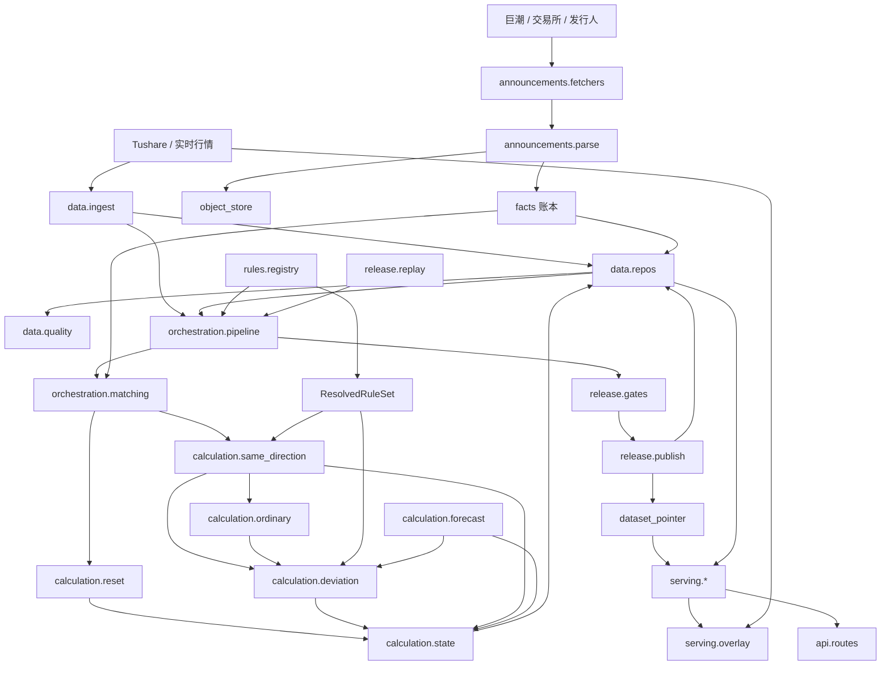

# 异动查查 vNext 架构评审与模块开发设计方案

> 评审人：顾图南（软件架构 / 研发部）
> 评审日期：2026-10-27
> 评审对象：`PRD-NEXT-20261027.6`、`ARCH-NEXT-20261027.5`、`模块化架构评审回执_2026-10-27`
> 现网基线：仓库 `Stock-Abnormal` 1.0.x（`server/` 16 个 Python 模块 / 14,909 行，其中 `services/market_service.py` 单文件 3,929 行）
> 分工说明：本文只负责**模块边界、依赖方向、接口签名、数据结构、数据流与时序、算法、门禁、迁移路线**。物理表结构、索引、事务隔离与缓存键设计以宋砚秋《数据模型与性能设计评审》为准，本文在需要时引用其表组编号（A–J 组），不重复定义。
> 本文不修改任何现有代码与文档。所有代码引用格式为 `文件:行号`。

---

## ① 评审结论

**一句话总判：**

> 两份文档在**规则语义层面**已达到可开发水准（四组状态、四项指标、公告确认计次、重置边界、缺因不可转安全的方向都是对的），但在**工程可落地性层面尚不具备开工条件**：架构稿宣称的「三页读同一已发布数据集」在当前代码里根本不存在（单股是在线现算、预测是后台快照、监控是第三套快照，且 `MarketService` 与 `OfficialMonitorService` 在 `app.py` 里互相注册回调形成真实循环依赖）；`dataset_version` 在 PRD/架构稿里被要求为结果必带字段，而代码里只有一个 `(dataset_role, target_trade_date)` 主键的 `prediction_dataset` 表、没有任何版本指针与原子发布；`rule_version` 存在三个互不相认的标识符且被数据库列宽反向约束；停复牌的现网实现与 PRD 4.4 语义**完全相反**。若直接按现网结构做 vNext，只会把 1.0.x 的耦合固化成"模块化外壳 + 上帝模块内核"。

**判定：有条件不通过。** 必须先闭合 9 项 P1（见 ②），其中 P1-1/P1-3/P1-6 属于**架构级**阻塞（决定模块能否拆开），P1-2/P1-4/P1-5/P1-7/P1-8/P1-9 属于**契约与口径级**阻塞（决定验收标准能否写成断言）。P1 全部闭合后，PRD + 架构稿 + 本文第 ⑦ 章可直接作为开发实施文档。

**三个最需要管理层知道的判断：**

1. **架构稿缺一个模块。** 五层（数据→规则→计算→公告→业务服务）在数据语义上是自洽的，但"业务服务"同时承担了「编排（orchestration）」与「发布门禁（release/gating）」两种性质完全不同的职责。这直接导致：门禁项被零散写在业务服务的 if 分支里（`market_service.py:2893-2899` 的基线完整性、`2959` 的 snapshot_complete），没有注册表、没有结果对象、无法断言"哪些门禁跑了、哪些没跑"，也就无法验收 `PRD §11` 的 13 条。**必须拆出第 6 个模块 `release`。**
2. **"公告事实 ↔ 计算匹配"在架构稿里被描述为单向，在代码里是双向环。** 架构稿 §1 说"业务服务编排匹配请求、计算模块执行确定性匹配"，这是对的；但 `app.py:29-30` 把 `MarketService` 与 `OfficialMonitorService` 互相注入（`set_monitor_provider` + `set_snapshot_published_callback`），两个 service 互为上下游，任何一方的快照更新都会反向触发另一方重算。这不是"双向匹配"而是"双向依赖"，必须靠第 ⑦ 章的 `orchestration.matching` + 只读的 `FactView` 打破。
3. **性能不是瓶颈，架构放大的耦合才是。** 纯计算量级很小（全市场 5,400 只 × 3 窗口 ≈ 10^7 次浮点，向量化后可压到 200 ms 内）；真正的耗时在「每股全量遍历公告快照」（`market_service.py:1188-1220`、`1288-1371`，O(N×M) ≈ 8.6×10^6 次迭代/日，实测 30–120 s）与「公告正文/OCR 串行」（单篇最坏 96 s）。这两处都是**数据结构与任务形态问题，不是算法问题**，靠第 ⑦ 章的 symbol 哈希索引与正文解析队列即可解决，不需要换技术栈。

---

## ② P1 阻塞问题清单（必须解决才能开发）

### P1-1 三页"同一已发布数据集"在架构上未被定义，也无 `dataset_version` 载体

**现象与证据**

- 架构稿 §2 边界约束第 6 条："业务服务是唯一产品流程编排者；单股、监控、预测从同一已发布数据集读取"；§5："一个 `dataset_version` 固定行情、证券资料、日历、公告事实、重置边界、计算结果和 `rule_version` 的引用关系"；§8 评审标准第 4 条重复此要求。PRD §11.4 也要求"单股、重点监控、预测同一数据集、规则版本和结果"。
- 现网完全不满足，且是三套互不相同的读取路径：
  - **单股**：`detail()`（`market_service.py:2997-3021`）→ `_detail_from_repository()`（`:2107`）每次请求都从 MySQL 取 `stock_calc_base` 单行 + `index_calc_base` 单行，然后**在线调用** `_vector_metrics()`（`:2156`）当场计算四项，并**当场读取最新的 monitor 快照**（`_rule_vectors_for_stock` `:1411-1412`）。这是"请求时现算"，不是"读已发布数据集"。
  - **预测**：`_compute_prediction_from_repository()`（`:3037`）后台跑一遍全市场，结果写入 `prediction_dataset`（`market_calc_repository.py:151-169`），页面读这个快照。
  - **监控**：`OFFICIAL_MONITOR.read()`（`monitor_service.py:1403`）读第四套快照（SQLite `MonitorRepository`）。
- 后果是**同一时刻三页可能不一致**：monitor 快照在 14:00 更新了一条严重异动公告 → 单股页立刻按新重置边界重算 → 预测集仍是 12:00 生成的旧结果。这正好命中回执第 32 条已经暴露的生产风险，而架构稿声称已经解决。
- 数据库层没有 `dataset_version`：`prediction_dataset` 主键是 `(dataset_role, target_trade_date)`（`market_calc_repository.py:168`），`stock_calc_base` 是 `(ts_code)` 单表单行就地覆盖（`:98`），**没有任何版本号字段、没有版本指针、没有候选/已发布状态机**。

**影响**：PRD §11.4 / §11.7 / §11.10 三条验收标准无法写成断言；"数据失败保留上一版本"（PRD §9.3、架构稿 §4.5 第 7 步）无实现路径。

**建议怎么改**

1. 引入全局版本对象 `DatasetVersion`（定义见 ⑦.4.1），全部结果表加 `dataset_version` 列并纳入联合键。
2. 引入单行版本指针表（`dataset_pointer`，宋砚秋 I 组 `4.10`），**三页只读指针指向的那一个版本**，禁止任何页面读"当前最新写入的行"。
3. 单股页从"在线现算"改为"读 `four_metric_result` 表（按 dataset_version + security_id）"；盘中只在读出的结果上叠加 overlay，不重算事件账本与重置边界。
4. 一致性门禁 G09（⑦.9）在发布前断言：每一张预测卡都能在单股结果集中找到同 `(security_id, rule_key, window, direction, value, threshold, business_date)` 的项。

---

### P1-2 `rule_version` 三个标识符互不相认，且被数据库列宽反向约束

**现象与证据**

| 标识符 | 位置 | 实际消费方 |
| --- | --- | --- |
| `RULE_VERSION = "RULE-2026-10-24.1"` | `rules/catalog.py:14` | **无人消费**，只在 `rules/__init__.py:16` 被导出 |
| `PREDICTION_RULE_VERSION = "v67"` | `market_service.py:62` | 写入 `prediction_dataset.rule_version`（`:2909`、`:2967`、`:2987`）、返回前端 `calculationInput.ruleVersion`（`:2328`）、门禁比对（`:3667`、`:3681`） |
| `MONITOR_RULE_VERSION = "2026-10-zts-effective-date-cninfo-official-ordinary-event-direction-fact-ledger-ocr-v28"` | `monitor_service.py:45` | 快照状态键 `monitor_rule_version`（`:273`、`:1386`） |

三个版本串，语义重叠、粒度不同、互相不知道对方存在。而真正决定阈值的是 `catalog.py:60-72` 的 `BOARD_RULES` 字典——它连版本号都没带。

更严重的耦合：`test_market_service.py:31` 断言 `self.assertLessEqual(len(PREDICTION_RULE_VERSION), 40)`，注释理由是"现有生产 schema 用 40 字符列"（`market_service.py:60-61`）。**数据库列宽反向决定了业务规则如何命名**，这是典型的配置耦合反模式；而 `market_calc_repository.py:209` 又用一条 `ALTER TABLE ... MODIFY COLUMN rule_version VARCHAR(128)` 打补丁，说明这个约束已经被突破过一次。

**影响**：PRD §10「规则说明页、后端计算、模拟基础和接口文案引用同一 `rule_version`」直接落空；规则变更无法做到"新增版本 + 重算"，只能原地改字典。

**建议怎么改**

1. 唯一权威：`RuleVersion`（语义化，如 `RV-2026.10.24-a`），由 `rules/registry.py` 加载 `rules/sets/<rule_version>.yaml` 产出 `RuleSet`。
2. `dataset_version` 内嵌 `rule_version`；对外接口只暴露这一个值。
3. 删除 `PREDICTION_RULE_VERSION` / `MONITOR_RULE_VERSION` 两个常量（迁移期用别名映射，一个发布周期内清除）。
4. 阈值、板块适用性、指数映射、计次、重置范围、时间切换、预测政策**全部**进 YAML（⑦.7），代码只保留 schema 与解析。
5. 仓库加 CI 检查：`grep` 环（⑦.7.3）。

---

### P1-3 `MarketService ↔ OfficialMonitorService` 真实循环依赖，由 `app.py` 手工装配

**现象与证据**

```python
# server/app.py:28-30
OFFICIAL_MONITOR = OfficialMonitorService(SERVICE.client, ANNOUNCEMENTS)
SERVICE.set_monitor_provider(OFFICIAL_MONITOR.repository.active_snapshot)          # 计算侧 → 依赖公告侧
OFFICIAL_MONITOR.set_snapshot_published_callback(SERVICE.rebuild_predictions_from_existing_bases)  # 公告侧 → 回调计算侧
```

- `MarketService._active_monitor_for_stock`（`:1182-1253`）与 `_rule_reset_facts_for_stock`（`:1275-1380`）把整个 monitor 快照当入参消费；
- `OfficialMonitorService` 发布快照后又反向调用 `MarketService.rebuild_predictions_from_existing_bases`（`:387`）；
- 两侧都持有对方的可变引用，且都在对方的执行路径里被同步调用。

**影响**：架构稿 §8 评审标准第 1 条「公告与计算双向匹配不产生互相写最终状态的环」未通过。工程后果是（a）无法单独测试任一侧；（b）公告侧快照发布失败会静默影响计算侧结果；（c）`_rule_reset_facts_for_stock` 里的 `except Exception` 兜底（`:1372-1379`）会把"读快照失败"降级成"无公告事实"，即**把失败翻译成安全方向的空集合**——这正是 PRD §3.2「数据不可用不得变成安全」最容易被违反的地方。

**建议怎么改**

1. 依赖方向强制单向：`announcements → facts(持久化) → orchestration.matching → calculation`。
2. 计算模块只允许接收**已持久化的只读事实视图** `FactView`（⑦.4.4），不允许接收"服务实例"或"回调"。
3. 公告侧发布完成只写 `fact_ledger` 并置 `fact_batch.status=ready`；由 `orchestration.pipeline` 在下一个阶段消费，**不回调任何 service**。
4. `app.py` 只做依赖注入装配（允许），但注入的必须是接口而非具体 service，且禁止双向 setter。CI 加 import-graph 检查（⑦.7.3）。
5. 缺因化：`_rule_reset_facts_for_stock` 的异常分支必须返回 `unavailable` + `reason_code=source_failed`，而不是返回空列表（现网 `:1373-1379` 已经写了 `available: False`，但调用方 `_vector_metrics` 在 `ordinary_events=[]` 时会走"无公告"分支——`engine.py:1982` 的 `if ordinary_events is not None` 判断无法区分"空列表"与"不可用"）。**这是一个必须修的语义漏洞。**

---

### P1-4 停复牌实现与 PRD 4.4 语义相反，且停牌原因无正式来源

**现象与证据**

- PRD §4.4 第七列：「普通事项停牌后复牌：3/10/30 日偏离**不跨停牌拼接**；从复牌交易日建立新窗口」；正文又写「停牌/复牌时，停牌前最后一个有效收盘价和基准指数点位作为复牌首个有效收益日的比较基点……停牌前更早的收益**不跨停牌拼接**」。
- 现网 `_trim_vectors_after_suspension`（`market_service.py:1088-1127`）的 docstring 明确保留相反语义：

  > 「识别停牌尾部，但**保留停牌前的有效交易日**。停牌日没有收益区间，不补 0，也**不应把此前有效交易日从滚动规则中清除**。否则 10 日同向次数会被错误归零，30 日窗口也会退化成复牌后的短窗口。」

  代码行为与注释一致：只 `return ordered_stock[-30:]`，不做任何窗口切断。
- 停牌识别方式是**从向量日期缺口反推**（`:1117` `missing = [day for day in index_dates if day < stock_latest and day not in stock_dates]`），不是来自正式停复牌状态源。
- `suspend_d` 接口存在（`tushare_client.py:193-201`）但**只用于 `history_coverage` 审计展示**（`market_service.py:603`），不参与任何计算。
- PRD §4.4 要求「停牌原因由交易所/上市公司正式公告或交易状态来源分类，区分『严重异动相关停牌』和『普通事项停牌』；不能只凭停牌时间与异动日期相邻来推断因果」。现网**没有任何停牌原因字段**，`suspend_d` 的 `suspend_type` 只区分 S/B，不含原因分类。

**影响**：PRD §11.2 / §11.12 两条验收无法通过；且这是回执第 30 条已经点名、要求"实施时必须明确迁移并回归"的差异项。

**建议怎么改**

1. 重写为 `calculation/reset.py :: derive_reset_boundary`（伪码见 ⑦.6.4），**每个指标一段窗口（WindowSegment）**，停牌与复牌各产生一个边界事件。
2. 停牌原因的权威来源优先级：交易所公告/发行人公告（公告模块解析）> 交易状态源（`suspend_d`，仅能给"是否停牌"，不能给原因）。**只有公告能给原因。**
3. 原因未确认时的兜底（必须写进 PRD）：3/10/30 偏离按"不跨停牌拼接、复牌建新窗口"处理（这是**安全侧**，不会低估风险）；10 日同向事件**保持 `pending_verification`，不清零也不延续**，四项中受影响的项标 `unavailable` + `reason=suspension_reason_unknown`。落到现网就是删掉 `_trim_vectors_after_suspension` 的"保留"逻辑，改为 `_trim_vectors_after_suspension` 只负责"识别尾部停牌"用于展示，窗口切断交给 `reset.py`。

---

### P1-5 缺因没有枚举、没有传播契约、没有类型系统

**现象与证据**

- PRD §3.4 定义了 `可用/不可用` 两级；§3.2 要求"状态卡显示待核验/数据不可用**原因**"；§11.9 要求"公告采集失败、正文待核验、证券无行情、指数未对齐均能显示**明确缺因**"。
- 现网只有两个自由文本/弱枚举：
  - `data/stock_state.py:58-63` 的 `data_state ∈ {available, partial, unavailable}` + `dataError` 字符串（默认文案写死在 `:99`）；
  - `ruleFactsQuality.status ∈ {not_configured, unavailable, pending_verification, partial, available}`（`market_service.py:1319-1336`），只覆盖公告一侧。
- 现网缺因来源散落在至少 6 处，文案各异且无 code：`:2231`（"缺少有效的收盘基准日或下一交易日"）、`:2233`（基准未对齐）、`:2360`（历史覆盖 + 实时不可用拼接）、`:2573`（"Tushare 当日收盘数据尚未入盘"）、`:2700`（同上）、`:2662`。
- 前端 `prediction/index.js:83` 只消费一个布尔 `dataUnavailable`，拿不到原因。

**影响**：无法做门禁断言（"不存在 status=safe 且 reasons 非空"这条最关键的检查写不出来），也无法做运营统计与告警分级。

**建议怎么改**

1. 建立 closed enum `MissingReason`（24 项，见 ⑦.10.1；落库用细码、告警按 7.10.3 粗码聚合），禁止自由文本。
2. 每个 `MetricResult` 强制携带 `status ∈ {triggered, safe, may_trigger, unavailable}` + `reasons: tuple[MissingReason, ...]` + `reason_text`（由 code 查表渲染，不在后端拼业务判断文案）。
3. 传播规则（⑦.10.2）：单项缺因**不传染**其他三项（PRD §3.5.4）；但**缺因优先于安全**——任一 `reasons` 非空时 `status` 不得为 `safe`。
4. 前端契约：`dataUnavailable` 布尔改为 `dataState` + `reasons[]`。

---

### P1-6 发布门禁缺项，且没有原子发布与回滚机制

**现象与证据**

- 架构稿 §4.5 第 6/7 步与 §5 列了发布前校验项，PRD §9.3 要求"候选数据集通过完整校验后**原子发布**；失败继续提供上一成功版本"。
- 现网实际门禁只有两处硬编码 if：
  - `market_service.py:2893-2899`——today 数据集的股票/指数基线完整性与日期匹配，不满足则 `raise RuntimeError`；
  - `market_service.py:2959`——`snapshot_complete` 布尔，不满足则 `status="incomplete"`。
- 缺失的门禁（对照 PRD §11 与架构稿 §5）：日历完整性、证券/板块/指数映射解析率、公告批次完成度、正文可读率、事实身份完整性、匿名事实计数、跨页一致性、规则版本一致性、`no_silent_safe`、未来事实过滤、行情时间单调性、重放一致性、PDF 生命周期。
- 无原子性：`save_prediction`（`market_calc_repository.py:788`）是 `INSERT ... ON DUPLICATE KEY UPDATE`，**直接覆盖** `(dataset_role, target_trade_date)` 行；`upsert_market`（`:617`）直接覆盖 `stock_calc_base` 单行。发布失败时（`:2977-2995`）today 会再写一次空 items 的 `incomplete` 行——**等于把旧数据覆盖成空**，与 PRD §9.3「失败继续提供上一成功版本」相反（这正是 PRD §11.10「不能因预测接口返回空规则而把单股卡片显示为安全」想防的场景）。
- 无回滚：没有任何机制能把指针退回上一版本。

**建议怎么改**

1. 新增 `release` 模块（⑦.2），含 `gates.py`（G01–G15 注册表，见 ⑦.9）+ `publish.py`（CAS 指针切换）+ `rollback.py` + `replay.py`。
2. 原子发布 = 单行 CAS：`UPDATE dataset_pointer SET published_version_id=:new WHERE env=:env AND published_version_id=:old`，影响行数 ≠ 1 即失败。
3. 候选结果写入独立版本分区（按 `dataset_version` 分键），**发布前不覆盖任何线上可读行**。
4. 失败路径禁止覆盖旧版本：只写 `dataset_version.status=rejected` + `gate_results` + 告警，指针不动。
5. 每次发布前自动执行回滚演练（灰度环境），并保留最近 N=10 个版本可回切。

---

### P1-7 次日预测依赖的"未来未知量"没有定义口径

**现象与证据**

PRD §5.1 的「次日结论」与 §7 的「次日预测」都依赖"次日可能触发"，但次日存在三个未知量，PRD 全部未定义：

1. **次日指数收益**。现网隐含假设为 0：`_next_day_rule_candidates`（`:1691-1692`）给指数追加 `{"date": projected_date, "return": 0.0}`；`_required_change_percent`（`:1563-1564`）的 `index_total` 只取**已知**日期，等于假设目标日指数收益 = 0。代码注释（`:1506-1526`）解释了两套路径的切片差异，但从未说明"指数次日收益假设为 0"这个前提。
2. **次日股票可达涨幅**。`:1644` `limit = float(limit_price_ratio or rule.limit_price_ratio or 10.0)`，用板块涨跌幅上限作为可达边界，再在 `:1664` 判 `0.0 <= distance <= limit`。这个"可达即可视为可能触发"是产品口径，PRD 未写。
3. **次日 10 日同向**。`:1706-1715` 用"行情候选 + 一个虚拟的新事件"预测次日同向达标（`projected_count += 1`）。但 PRD §4.3 明确"计次实体是**公告确认且匹配**的普通异动事实"，次日的公告尚不存在。也就是说，现网是在用一个 PRD 明确禁止的口径生成次日同向卡——而 PRD §7 又要求"次日预测筛选严重异动结果：10 日同向……可能触发"。**PRD §4.3 与 §7 在此处自相矛盾。**

**影响**：`PRD §5.1` 的次日结论表（安全/触发普通/触发严重/暂不可用）在"触发严重"这一档的成立条件无法判定；`§11.6` 无法验收。

**建议怎么改**

1. 显式声明 `ForecastAssumptions`（⑦.4.6）并作为接口字段返回，前端在规则说明页展示。
2. 默认口径（保守、可解释、可复算）：
   - `index_return_next_day = 0.0`（假设 ID `IDX-FLAT-0`），可配置切换为情景模式，但默认只能是 0；
   - 可达性边界 = **该证券**当日涨跌幅上限（不是板块默认值），由 `PriceLimitPolicy` 解析（⑦.4.3）；
   - 次日 10 日同向 = **仅计算候选**，必须携带 `assumption=pending_announcement`，卡片文案固定为「次日可能触发：10 个交易日内出现 N 次同向普通异动（假设次日异动被公告确认）」，且 `may_trigger` 不进入正式事件账本。
3. 在 PRD §4.3 增补一句：「次日（N）的 10 日同向『可能触发』为计算候选，其成立以『次日 3 日窗口达标且被公告确认』为假设前提，不构成正式计次，也不生成监管事实。」

---

### P1-8 公告采集/正文解析/PDF 生命周期的工程形态未定义

**现象与证据**

- PRD §6 要求"普通异动、严重异动、风险提示、停复牌、终止上市分别记录来源类型和覆盖边界"、"采集失败、未找到、正文不可读、确认无事实必须区分"；架构稿 §4.4 要求"去重、公告更正关联、正文完整性和事实置信状态"。
- 现网形态：
  - 采集是**同步串行 for 循环**：`announcement_service.py:150-191`，3 栏目 × 4 关键词 × 最多 8 页 = 最坏 96 次串行请求，单次超时 10 s（`:129`）；
  - 正文解析在 `monitor_service.refresh()` 主循环里**逐条同步调用**（`:1029-1032`），无队列、无并发控制；
  - OCR 是 CPU 密集且**按页 12 s 超时**（`announcement_service.py:229`、`:234`），单篇最多 8 页 → **单篇最坏 96 s**；Dockerfile 已装 `tesseract-ocr-chi-sim`，在云托管 0.5–1 vCPU 上单页实测 1.5–5 s；
  - PDF 生命周期实现是**容器本地文件缓存**：`monitor_service.py:797-848` `_pdf_path` / `_cache_active_pdfs`，写在容器临时盘——与云托管多实例 + 无状态容器模型冲突（宋砚秋 P1-7 已指出同类的 SQLite 问题，此处是文件版）；
  - `contentHash` 用的是 `sha256(f"{title}\n{body}")`（`:1094`、`:1158`、`:1208`），即**正文内容参与哈希**。同一公告 OCR 置信度不同 → 正文略有差异 → 哈希变化 → 幂等键漂移，与"同一事实只计一次"（PRD §4.3）冲突。

**影响**：PRD §6 与 §11.13 无法验收；日终任务耗时不可控；多实例下 PDF 打开概率性 404。

**建议怎么改**

1. 拆三个独立任务：`fetch`（列表，幂等、可重放）→ `parse`（正文 + OCR，有界并发 worker 池）→ `lifecycle`（PDF 对象存储与清理）。
2. `parse` 用队列 + 4–8 worker（按容器 vCPU 配置），单篇总超时 20 s，OCR 走独立低优先级池；结果按 `object_sha256`（**PDF 二进制哈希，不是正文哈希**）缓存，命中即跳过。
3. PDF 迁对象存储（COS），`DB` 只存 `object_key + source_url + sha256 + 正文证据 + 解析质量 + 清理记录`（宋砚秋 D 组 `4.5`）。
4. 采集覆盖可量化：每次采集产出 `fact_batch{id, sources, columns, keywords, status, checked_at}`，门禁 G05 消费它（⑦.9）。
5. `contentHash` 改为 `sha256(pdf_bytes)`；`body_hash` 保留但降级为"解析质量证据"，不参与幂等键。

---

### P1-9 预测页实际不含「10 日同向」卡，与 PRD §7 冲突（需产品裁决）

**现象与证据**

- PRD §7（第 176 行）：「预测只筛选严重异动结果：**10 日同向**、10 日偏离、30 日偏离当前已触发或在目标日可能触发。」
- 实现相反：`_prediction_item_allowed`（`market_service.py:266-270`）对 `same_direction_10d` **直接 `return False`**（`:282-283` 还有一段不可达的重复分支）；注释写"同向次数仍参与单股状态判断，但不再生成或展示预测卡片"。预测页实际只有 `severe_10d` 与 `severe_30d` 两张卡。
- 更矛盾的是：单股页的次日预测**确实**会生成 `same_direction_10d` 候选（`_next_day_rule_candidates:1681-1719`），只是被预测页过滤掉了。即**能力存在、被人为屏蔽**。
- 与宋砚秋《数据模型与性能设计》P1-6 为**同一处冲突的独立发现**，两条评审线同时命中。

**影响**：PRD §11.4「预测不得出现单股没有的四项状态」的反向约束（单股有的、预测也应有）无法验收；且 10 日同向是三档严重规则之一，缺失会导致预测页漏报一整类严重风险。

**建议怎么改（我倾向改实现、保留 PRD）**

1. 保留 10 日同向卡（它是独立严重规则，PRD §4.2 明确列为严重级，删掉等于弱化产品）。
2. 卡的口径见 ⑦.4.8(d) —— 关键是 `may_trigger` 必须由「N 日上一个具体达标的 3 日窗口」支撑，不能凭空 `+1`；废弃现网"追加 ±limit 虚拟日收益"的做法（`market_service.py:1686-1719`）。
3. 卡片强制携带 `assumptions: ["pending_announcement"]` + 固定文案，**不进正式事件账本**（C-2）。
4. 若产品最终决定删除该卡，则**必须同步修改 PRD §7 第 176 行**，并在规则说明页声明"预测池不含 10 日同向"，否则文档与实现长期不一致。

**需产品拍板**：保留（改实现）还是删除（改 PRD）。**默认建议保留。**

---

## ③ P2 重要问题清单

> 按"影响面 × 修复成本"排序。P2 不阻塞开工，但必须在 M5 前闭合，否则会变成上线阻塞。

### P2-1 基准指数映射硬编码，且无映射时默认回落沪指
`market_service.py:47-48, 158-164`。`_index_code_for_stock` 在 `board` 与 `market` 都取不到时 `return INDEX_BY_MARKET.get(..., "000002.SH")`（上证 A 指）。一旦 Tushare `stock_basic` 的 `market` 字段缺失，**深市股票会按沪指算偏离**。
**建议**：映射进规则版本 YAML（含 `index_effective_from/to`）；无映射 → `reason=mapping_missing`，四项全 `unavailable`，**禁止默认回落**。

### P2-2 次日可达涨幅用板块上限，且 ST 的 5% 硬编码在业务服务
`market_service.py:2212` `forecast_limit = 5.0 if is_st else rule.limit_price_ratio`；`catalog.py:62-71` `limit_price_ratio` 写死 10/20/30。
**建议**：`PriceLimitPolicy` 由 `(board, security_attrs{is_st, is_new, listing_days, delisting_period}, trade_date, rule_version)` 解析（⑦.4.3），缺省 → `unavailable`。

### P2-3 预测池资格策略写死在代码里，且排除原因只有计数
`_prediction_stock_eligible`（`:486-501`）排除 ST / 非 L 状态 / `priceLimitEnabled=False` / 名称含"退" / 上市日 ≥ 目标日——这是 5 条产品口径，PRD 一条都没写。排除原因只落 `exclusion_stats` 计数（`:3052-3053`），PRD §7 要求"接口返回排除原因"。
**建议**：资格策略进 `ForecastPolicy` YAML；`exclusions: list[{security_id, rule_key, reason_code, reason_text}]` 随接口返回。

### P2-4 前端"首次打开刷新"实际只在设备生命周期内触发一次
`prediction/index.js:42-54`：`firstOpen = !wx.getStorageSync('predictionFirstOpenRealtime:v2')`，该 key **永不清除**。即用户第一次安装后，之后每一次进入预测页都只走 `GET /api/predictions`，**再也不刷新**。直接违反 PRD §5「首次打开异动预测或单股详情时，业务服务先读取并刷新可用的已发布数据集/模板结果」与 §11.6。
**建议**：改为**每次进入页面（onLoad / onShow 跨 Tab）触发一次**编排刷新；进程内/会话内去重，跨会话不去重。

### P2-5 单股页完全没有刷新编排
`stock/index.js` 只有 `getStockDetail`（无 refresh），与 PRD §5「两个页面的首次刷新规则一致」不符。
**建议**：抽出公共 `session.refresh(page, security_ids)` 编排，两页共用。

### P2-6 单股详情每次请求无条件打实时行情源
`_detail_from_repository:2138` `quotes = self._realtime.fetch_many([...])`，**不判交易时段、不判证券可交易状态**。`fetch_many`（`realtime_quote.py:72-96`）内部三源串行回退、单源超时 4 s → 最坏 12 s；前端 `getStockDetail` 超时被迫设 30 s（`api.js:9`）。
**建议**：闸门前置（`time_policy.in_trading_session(now) and trading_state == NORMAL`）；加源级熔断器（连续 N 次失败短路 60 s）；指数行情做 30 s 共享快照。

### P2-7 在线路径全表加载 + 每股 O(M) 事实遍历
`_refresh_existing_prediction_scope:3791-3792` 每次刷新 `all_calculations()`（5,400 行 JSON）+ `all_indexes()`；`:3820` 对每张卡再调一次 `_rule_vectors_for_stock`（内部 2 次全量快照遍历）。预测集生成（`:3075`）与日终更新（`:2675`）同样如此。
**建议**：symbol → facts 哈希索引（⑦.8.3）；在线只 `WHERE ts_code IN (...)` 取所需股票；指数向量常驻缓存（按 `dataset_version` 失效）。

### P2-8 券商风险提示被当作 primary source
`announcement_service.py:26-30` `source_policy` 把 `broker-risk-alert` 标为 priority 1「18.cn 主源」，`issuer-disclosure` 降为 priority 2；`monitor_service.py:1202-1204` 给券商条目打 `sourceRole="broker_primary"`。而 PRD §4.4 要求"普通异动正式事实**必须有公告正文确认**"、§6 称交易所/发行人官方页面为"补充或校验源"。**主备关系与 PRD 相反。**
**建议**：严重/普通监管事实只认交易所 + 发行人正式公告；券商风险提示降级为 `supporting` 证据（可展示、可触发补采，不构造监管事实）。

### P2-9 "15:00 初态"用实时行情充当收盘，与 PRD §8.1 冲突，且文档层面不存在
`update_initial_data`（`:2729-2799`）在 15:00 用 `self._realtime.fetch_many` 拉全市场 5,400 只 + 5 个指数（`:2748`）当收盘数据落 `data_stage='initial'`。PRD §8.1 写的是"15:00 后**等待收盘数据集发布**"，且 PRD/架构稿全篇没有 `initial/formal` 两阶段的概念。该设计还带来 54 批 × 3 源最坏 162 次实时请求的负载。
**建议**：vNext 明确取消"用实时行情造收盘初态"。若确需盘中可用的 provisional 数据集，必须（a）在 PRD §8 增加"盘中数据集"角色定义与展示口径；（b）只覆盖预测池内股票（量级 10^2），不做全市场；（c）结果强制标 `provisional` + `quote_source` + `quote_time`，前台显示"盘中参考，非收盘结论"。

### P2-10 除权除息日的收益可能被算错
`_append_daily_rows:2518-2523`：优先用 `pct_chg`，否则用 `close` 比值。Tushare `daily.close` 是**未复权价**，除权日 `close` 比值会算出虚假暴跌；而 `pct_chg` 字段在部分回补路径可能为 `None`，此时会走到 close 比值分支。
**建议**：ingest 层统一使用交易所口径的当日涨跌幅（`pct_chg` 或复权收益二选一，写进规则版本的 `return_definition`）；close 比值只作为**校验**用途，偏差 > 阈值（如 0.1%）且当日有除权事件 → 标 `quote_suspect` 并告警，不静默采用。

### P2-11 公告关键词硬编码，覆盖率无量化
`announcement_service.py:22` `keywords = ("股票交易异常波动", "股票交易严重异常波动", "股票交易风险提示", "停牌核查")`，标题白名单过滤在 `:169`。北交所/科创板措辞差异、更正公告、"核查结果暨复牌公告"等变体的召回率**没有任何度量**。
**建议**：关键词与标题规则进配置；建立"召回率回归集"（人工标注 N=200 条已知公告，每次配置变更跑一遍），门禁 G05 输出 `sourceCoverage[]`。

### P2-12 无重放工具，规则变更无法验证
现网只有 `_rebuild_predictions_if_rule_changed`（`:355`），是"版本变了就重建"，**没有"同一输入重跑必须得到同一输出"的断言**，也没有历史版本对比。
**建议**：`release/replay.py`（⑦.9 G14），按 `inputs_digest` 重跑并对拍；规则版本变更时强制对最近 20 个交易日重放。

### P2-13 调度与缓存在进程内，云托管多实例下会分裂
`app.py:25-30` 模块级单例 + `SERVICE.start_scheduler()` / `OFFICIAL_MONITOR.start_scheduler()`（`app.py:402-403`）各起后台线程；`_market_update_lock`（`market_service.py:2534`）只是**进程内**锁；`_prediction_cache`（`:194`）、`_stocks_cache`（`:191`）是进程内 dict。多实例下每个实例各跑一份日终任务、各自缓存不同版本。
**建议**：任务用 Redis 租约（`SETNX job:{name}:{business_date} EX 900` + 心跳）；缓存键含 `dataset_version`（宋砚秋 ⑦ 章）；API 实例与 worker 实例按进程角色分开部署（架构稿 §7 已允许）。

### P2-14 `history_coverage` 的停复牌核验结果不参与计算
`market_service.py:596-615` 拉 `suspend_d` 只为生成审计分类（`:686-693`），计算路径完全不用它。PRD §4.4 要求的"严重异动相关停牌 vs 普通事项停牌"分类需要停牌事实进 `reset_boundary`。
**建议**：`suspend_d` 落地为 `trading_state_day` 表（宋砚秋 B 组 `4.3`），成为 `derive_reset_boundary` 的一等输入。

### P2-15 搜索走内存全表扫描
`search()`（`:513-565`）对 5,400 行做 Python 子串 + 拼音首字母匹配。
**建议**：低频但简单——迁 MySQL 前缀索引 + `name_initials` 列（现网已有 `stock_basic.name_initials`，`market_calc_repository.py:85`）或接微信云开发的搜索能力。

### P2-16 模拟计算的输入边界未定义，可能与正式结果不一致
`calculationInput`（`:2328`）给了 `ordinaryResetDates / severeResetDate / ordinaryEvents`，但前端 `simulation.test.js` / `index.js:384-410` 是否应用重置边界未验证。若模拟不应用重置，用户会算出与后台不同的数。
**建议**：模拟必须复用**同一套** `deviation` + 重置边界口径（前端按相同伪码实现，或后端提供 `POST /simulate` 纯计算端点）；结果必须带 `ruleVersion` 与"仅 10/30 日偏离"限制文案。

---

## ④ 遗漏 / 未定义口径清单（含建议决策）

> 这一章回答"凡文档没写但工程上必须决策的"。每条给出**冲突点 / 建议口径 / 需要落到哪份文档**。
> 标记：`[PRD]` 需补进 PRD；`[ARCH]` 需补进架构稿；`[RULE]` 进规则版本 YAML（不进代码）。

### 4.1 计次类

| # | 口径 | 冲突 / 空白 | 建议决策 | 落点 |
|---|---|---|---|---|
| C-1 | **重叠窗口计次** | PRD §4.3 说"一个公告若明确描述多个独立事实，逐项匹配后可逐项计次"；现网 `consolidate_same_direction_events`（`engine.py:296-352`）把**连续重叠的行情窗口合并成一个 episode**，而正式账本走 `confirmed_same_direction_event_ledger`（`:355-405`）**不合并**。两套策略并存，PRD 未说明适用范围。 | 计次实体 = **fact**（PRD 已定，坚持）。同一 `fact_id` 只计一次；**不同 `fact_id` 即使区间重叠也分别计次**。行情候选的 episode 合并**仅用于"无公告时的候选证据展示"**，永不参与计次。 | `[PRD] §4.3` 补一句；`[RULE] same_direction.counting_policy` |
| C-2 | **次日 10 日同向"可能触发"** | PRD §4.3 要求公告确认；§7 又要求次日预测包含 10 日同向可能触发。次日的公告不存在。 | 见 P1-7 第 3 条：仅计算候选 + `assumption=pending_announcement` + 固定文案，不进正式账本。 | `[PRD] §4.3 / §7` |
| C-3 | **同向计数的方向独立性与并列展示** | PRD §4.3"上涨和下跌分别计数"，未定义 up=3/down=3（阈值 4）时怎么展示。 | 两方向**独立展示**计数与阈值；任一方达阈值即触发；展示"主要方向"取较大者，**并列时同时展示两方向**，不任选其一。 | `[PRD] §5.2` |
| C-4 | **10 日窗口按谁的日历** | PRD §4.3"最近 10 个交易日按 `fact_end_date` 统计"；§4.1 又要求"股票和所属基准指数必须使用共同有效交易日"。停牌时两者不同。 | **窗口边界按交易所交易日历**（D-9..D，**停牌不延长窗口**，否则监管期被人为拉长）；**事件归属日按 `fact_end_date`**；偏离类指标（3/10/30）的长度不足才标 `window_insufficient`。 | `[PRD] §4.3` |
| C-5 | **一般风险提示 / 券商风险提示的同向贡献** | PRD §4.2 已排除；但"含『严重异常波动』字样的券商/交易所风险提示"是否构成严重事实，未定义。 | 只有**交易所 / 发行人正式公告 + 正文确认**才构成监管事实；券商风险提示 = `supporting` 证据，可展示、可触发补采，**不构造事实、不计次、不重置**。对应修 P2-8。 | `[PRD] §6`；`[RULE] fact_authority` |
| C-6 | **跨源事实冲突**（巨潮 vs 18.cn vs 中泰 对同一事件给出不同区间/方向） | 完全未定义。现网按 `sourcePriority`（1=券商 > 2=发行人）取值，与 PRD §6"巨潮主源、交易所/发行人补充或校验"不一致。 | 权威顺序：**交易所公告 > 发行人公告（巨潮）> 其他**。冲突 → 该事件 `pending_verification` + `reason=source_conflict`，**不计次**；绝不用"多数投票"或"优先级 fallback"自动裁定。 | `[PRD] §6` |

### 4.2 预测类

| # | 口径 | 冲突 / 空白 | 建议决策 | 落点 |
|---|---|---|---|---|
| F-1 | **次日指数收益** | 现网隐含 0（`market_service.py:1563-1564`、`:1692`），PRD 未提。 | 默认 `IDX-FLAT-0`（0.0），显式返回 `assumptions.indexReturnNextDay`；允许规则版本切到情景模式，默认只能是 0。 | `[PRD] §5.1`；`[RULE] forecast_policy` |
| F-2 | **次日股票可达涨幅的边界** | `:1644` 用板块 `limit_price_ratio`，`:2212` 对 ST 用 5.0 硬编码。 | 用**该证券当日**涨跌幅上限（见 P2-2 / ⑦.4.3）；无 `PriceLimitPolicy` → 该规则项 `unavailable`，不用板块值兜底。 | `[RULE] price_limit` |
| F-3 | **ST / *ST 的偏离阈值** | PRD §3.1 说 ST 是属性；§4.2 阈值按板块。现网直接把 ST 排除出预测池（`:489`）。 | 偏离阈值**按板块不变**（交易所未对 ST 单独规定偏离阈值）；ST 只影响**次日可达涨幅**（5%）与预测池资格（策略化，不写死）。单股页照常展示四项 + ST 标签。 | `[PRD] §4.2`；`[RULE] forecast_policy.exclude` |
| F-4 | **新股上市首日 / 前 N 日** | 无涨跌幅限制（主板首日 44% 临停、双创前 5 日不限）+ 无 30 日历史。PRD 未提。 | `listing_days < 3` → 3 日 `history_insufficient`；`listing_days < 30` → 30 日 `history_insufficient`；涨跌幅上限 `unbounded` → 次日可达性无法判定 → 预测项 `unavailable`；`listing_days < 30` 排除出预测池，`reason=recent_listing`。 | `[PRD] §3.1`；`[RULE] price_limit` |
| F-5 | **退市整理期** | PRD §3.1 说是属性非状态；未给涨跌幅（沪深 10%）。 | 属性化 `delisting_period=true`；`PriceLimitPolicy` 给 10%（版本化）；**不进预测池**（`reason=delisting_period`）；单股照常展示四项 + 标签。 | `[PRD] §3.1`；`[RULE] price_limit` |
| F-6 | **预测页"关联 3 日卡"的资格边界** | PRD §7"已有严重监管事实期间，若 3 日普通规则可能触发，也生成关联预测卡"。未定义：到期当天算不算？距离阈值多少？ | 以 **D 日有效（含当日）** 为准（`effective_from <= D <= effective_to`，自然日 inclusive）；只要 3 日 `may_trigger` 成立即生成；**不得**单独作为普通市场预测池。 | `[PRD] §7` |
| F-7 | **盘中是否新增预测候选** | 现网 `_refresh_existing_prediction_scope`（`:3779-3790`）只刷新已有卡，盘中新达标股票不出现在预测页。PRD §7 说"当日盘中触发提示同步出现在预测页和单股页"。 | 明确为：**盘中不新增候选，仅在收盘数据集发布时纳入**，预测页顶部展示"盘中结果每 X 分钟随收盘数据集更新"；单股页显示盘中触发。避免用户认为漏报。 | `[PRD] §7` |
| F-8 | **"当日已触发"标签的保留边界** | PRD §7"保留到次日 09:00"。未定义：次日 09:00 后若 D+1 数据集尚未发布怎么办。 | 09:00 角色切换后：若新 dataset 未发布 → 显示"数据更新中"，标签清空（不留旧标签配新日期，遵守 PRD §8.1 末句）；若已发布 → 按新 D 计算。 | `[PRD] §8.1` |

### 4.3 时间与日历类

| # | 口径 | 冲突 / 空白 | 建议决策 | 落点 |
|---|---|---|---|---|
| T-1 | **跨年交易日历** | `_generate_prediction_datasets:2808-2810` 只取 D-3 .. D+15 自然日；跨年时次年日历可能未发布。 | 每年 11 月预取并校验次年日历；缺次年日历 → `reason=calendar_unavailable`，**所有 N 相关结果 `unavailable`**，禁止用"D+1 自然日"替代 N。 | `[PRD] §2`；`[ARCH] §6` |
| T-2 | **盘中（09:30–11:30/13:00–15:00）披露的公告何时生效** | PRD §4.4"公告次一交易日起按新基线重算"未区分披露时点。 | `reset_effective_date` = 公告披露日之后的**第一个交易日**（披露日 ≤ 当日 15:00 且为交易日 → 次一交易日）；**盘中公告不改变当日已发布 dataset**，只影响 T+1 与新 dataset_version。 | `[PRD] §4.4` |
| T-3 | **集合竞价 / 午间休市的刷新判定** | PRD §5 提到"集合竞价/连续竞价按交易日历和交易时段配置判定"，但时段表没给。 | `TimePolicy` 显式配置：`pre_open(00:00–09:00)`、`call_auction(09:00–09:25)`、`continuous(09:30–11:30, 13:00–14:57)`、`lunch(11:30–13:00)`、`post_close(15:00–24:00)`、`rest_day`。**只有 continuous 才发起实时刷新**；`call_auction` 与 `lunch` 不发。 | `[RULE] time_policy` |
| T-4 | **监管自然日倒数的端点** | PRD §8.1"监管自然日倒数使用自然日"；未定 inclusive。 | `remaining = end_date - D`（**含当日**，D == end_date 时 remaining = 0，当日仍算"监管中"）；次日起退出。与现网 `_remaining_natural_days`（`monitor_service.py:1455`）口径一致，保留并规则化。 | `[PRD] §8.1` |
| T-5 | **客户端时钟不可信** | 架构稿 §6"时间由交易日历和目标数据集确定，不由页面本地时钟独立推断"。 | 所有时间角色（D/N/盘中/次日结论）**由后端 `TimePolicy` 算好下发**；前端只渲染 `date_role` 字段，不自行 `new Date()` 判断。缓存键含 `dataset_version || date_role`。 | `[ARCH] §6` |

### 4.4 重置与边界类

| # | 口径 | 冲突 / 空白 | 建议决策 | 落点 |
|---|---|---|---|---|
| R-1 | **重置生效日落在停牌期间** | 未定义。现网用 `date >= reset_date` 一刀切（`_trim_vectors_after_rule_reset:1398-1399`），若 reset 后连续停牌会产生空窗口。 | 拆成两个字段：`effective_date`（规则生效日，= 公告次一交易日）与 `first_return_date`（新窗口首个有效收益日，= 复牌日或生效日）。窗口按 `first_return_date` 起算，长度不足 → `window_insufficient`。 | `[PRD] §4.4`；`[RULE] resets` |
| R-2 | **同日多公告**（普通 + 严重 + 风险提示同日） | 未定义。现网 `build_reset_context:130-137` 取 latest_date 且 severe 优先。 | 同日多公告按 scope **取并集**；若同时含严重与普通 → `scope=severe`（严重覆盖普通，**不叠加两次重置**）；风险提示不参与。 | `[PRD] §4.4` |
| R-3 | **停牌原因无法确认时的兜底** | PRD §4.4"保留事件账本并将受影响的重置判断标为待核验，不猜测清零或延续"——只说了同向，没说偏离。 | 偏离（3/10/30）：按**安全侧**处理 = 不跨停牌拼接、复牌建新窗口。同向：**保持 `pending_verification`**，不清零不延续，该项 `unavailable`。 | `[PRD] §4.4` |
| R-4 | **复牌跳空收益是否计入新窗口** | PRD §4.4"复牌日的跳空收益可以进入新窗口"——已定，但实现上未区分"停牌前最后收盘"作为基点。 | `baseline_price` = 停牌前最后一个有效收盘；`baseline_index_point` = 同日指数点位；复牌日收益 = 复牌收盘 / 停牌前收盘 - 1（**与 PRD 一致**）。现网 `_trim_vectors_after_suspension` 因保留旧收益，实际上不遵守此条。 | `[RULE] resets` |
| R-5 | **指数 / 板块 / 基准切换** | PRD §4.2"具体板块、基准指数和阈值必须由证券属性与规则版本确定"；未定义切换时的历史处理。 | `index_effective_from/to` 版本化。切换日**之后**用新指数；**不回溯改写历史 `dataset_version`**。切换期双算一遍并保留双结果，`rule_version` 变更触发全量重放。 | `[ARCH] §6`；`[RULE]` |
| R-6 | **证券身份变更**（代码变更、吸收合并、转板） | 完全未定义。 | `security_identity_conflict` → 四项全 `unavailable`；保留旧身份历史结果只读可查；新身份从 `list_date` 起重新累积窗口。 | `[PRD] §3.1` |

### 4.5 公告与事实类

| # | 口径 | 冲突 / 空白 | 建议决策 | 落点 |
|---|---|---|---|---|
| A-1 | **公告更正** | PRD §6"事实更正会生成新数据集版本并重算，不覆盖原始证据"。未定义关联方式。 | `fact.supersedes` / `superseded_by` 链；更正 → 新增事实（新 `fact_id`）+ 标记原事实 `superseded`；触发新 `dataset_version`；**历史版本不改写**，页面按当前版本事实展示，审计记录保留"某版本曾据此发布"。 | `[PRD] §6` |
| A-2 | **公告撤回 / 作废** | 完全未定义。 | 撤回公告 → 原事实 `status=withdrawn`；其派生的同向事件**软删**（保留审计行 `removed_at`）；触发新 `dataset_version`；若撤回导致监管状态从"严重"降为"安全"，必须走人工复核队列（防止自动降级误报）。 | `[PRD] §6` |
| A-3 | **"确认无事实"的成立条件** | PRD §11.11 已给（批次完成 + 覆盖校验通过 + 无匹配）。未定义证据留存。 | 落 `fact_batch{id, sources[], columns[], keywords[], per_source_status, checked_at}`；结果返回 `factBatchId`；门禁 G05 校验 `per_source_status` 全为 `ok`。**任一源失败 → 只能 `pending_verification`**。 | `[PRD] §11.11`；`[ARCH] §4.5` |
| A-4 | **事实正文哈希与幂等键** | 现网 `contentHash = sha256(title + body)`（`:1094`），正文随 OCR 抖动 → 幂等键漂移。 | 幂等键 = `source_id = sha256(source_url)`（优先）或 `sha256(symbol|announce_date|title)`；**对象哈希 `object_sha256 = sha256(pdf_bytes)`** 用于解析缓存；`body_hash` 降级为解析质量证据，**不参与幂等**。 | `[ARCH] §4.4` |
| A-5 | **终止上市 / 摘牌后的处理范围** | PRD §3.1"保留身份、公告和最后结果，不进入新的预测"。未定义：是否继续更新公告事实？ | 继续采集公告（用于证据完整性与终止上市事实确认），**不计算四项、不进预测池**；最后成功结果按"最后成功 dataset_version"只读保留并标注日期。 | `[PRD] §3.1` |
| A-6 | **PDF 清理后的页面行为** | PRD §6 已定（优先原文链接，不可用则提示已按策略清理）。 | 实现要点：清理写 `pdf_purge_log(object_key, purged_at, reason, fact_id)`；接口返回 `pdfAvailable=false` + `sourceUrl` + `purgeNotice`；**不返回失效的对象直链**。 | `[ARCH] §4.1` |

### 4.6 状态与展示类

| # | 口径 | 冲突 / 空白 | 建议决策 | 落点 |
|---|---|---|---|---|
| S-1 | **"待核验"是否为独立状态** | PRD §3.2 写"状态卡显示待核验/数据不可用原因"，§3.4 又说"不可用不是监管状态"。 | 状态机只有 `SAFE/ORDINARY/SEVERE` 三态 + `UNAVAILABLE` 展示族；**"待核验"是 `UNAVAILABLE` 下的一个 `reason` 类**，不是第四种监管状态（避免与 PRD §3.2"严重优先于普通"的两态模型冲突）。 | `[PRD] §3.2` |
| S-2 | **"当日已触发"与"监管中"同时成立** | PRD §5.1 两条并列，未定优先级。 | 显示「当日已触发严重异动」优先（事实更新），并在监管事实摘要里**并列**展示有效期与公告。 | `[PRD] §5.1` |
| S-3 | **3 日"已触发"但公告未匹配时的展示** | PRD §3.2 已定"不得显示安全，显示待核验"。未定义卡片配色。 | 卡片 `status=unavailable`，**不用安全色也不用黄色**；文案固定"3 日偏离已达计算阈值，等待公告确认"；数值照常展示（不隐藏）。 | `[PRD] §5.2` |
| S-4 | **模拟计算是否应用重置边界** | PRD §5.3 未提。 | **必须应用**（否则模拟与正式结果不一致构成误导）；模拟输入增加 `resetBoundary` 段；结果带 `ruleVersion` + "仅 10/30 日偏离"限制。 | `[PRD] §5.3` |
| S-5 | **灰度与回滚环境** | 全部文档未提。 | `dataset_pointer` 加 `env` + `canary_ratio`；灰度流量读 candidate 版本并与 published 对拍，差异告警；任何版本可做回滚演练。 | `[ARCH] §7` |

---

## ⑤ 性能可行性评估与优化建议

### 5.1 估算前提（显式列出，便于复核）

| 参数 | 取值 | 依据 |
|---|---|---|
| 活跃 A 股数 N | 5,400 | 沪深北合计，与 `stock_basic` 量级一致 |
| 每只保留收益点 | 30 | `vector[-30:]`（`market_service.py:2524`、`:2648`） |
| 指数数 | 5 | `INDEX_BY_MARKET` 3 + `INDEX_BY_BOARD` 去重（`market_service.py:2619`） |
| 公告快照条目 M | 10²–10³（取 800） | `refresh()` 回看 90 自然日 × 三源（`monitor_service.py:985`） |
| 日终需解析公告 | 20–60 篇（取 30） | 巨潮关键词命中 + 18.cn + 中泰 |
| OCR 占比 | 20–40%（取 30%） | 扫描件比例经验值 |
| 容器规格 | 0.5–1 vCPU / 1–2 GB | 云托管默认档（保守假设） |
| 预测卡量级 | 10² | `prediction_dataset.item_count` |

### 5.2 日终重算耗时拆解（现网串行）

| 阶段 | 代码位置 | 量级 | 耗时估算 | 占比 |
|---|---|---|---|---|
| ① Tushare 接入 | `:2542` `stock_basic`、`:2576` `daily(trade_date)`、`:2623` `index_daily` | 3–7 次请求，单次 1–3 MB | 10–30 s | 3–8% |
| ② 收益向量增量 | `_append_daily_rows:2497-2527` | 5,400 × ~60 操作 | 0.3–1 s | <1% |
| ③ 指标计算 | `_vector_metrics:1723-2011` | 5,400 × (3 窗口 × ~30 子窗口 compound + 28 个 3 日候选) ≈ 10^7 浮点 | 3–11 s | 2–5% |
| ④ **事实匹配** | `_rule_vectors_for_stock:1402` → `_active_monitor_for_stock:1188` + `_rule_reset_facts_for_stock:1288`（**每股 2–3 次全量遍历 M**） | 5,400 × 3 × 800 ≈ **1.3×10^7** 次迭代 + 匹配项上的 `urlparse`/哈希校验 | **30–120 s** | **15–25%** |
| ⑤ 预测集生成 | `_compute_prediction_from_repository:3037`（重跑 ③+④） | 同 ③+④ | 33–131 s | 17–27% |
| ⑥ 落库 | `upsert_market:617`（5,400 行 + 5 指数，JSON 列） | 批量 executemany | 3–15 s | 2–5% |
| ⑦ **公告采集 + 正文** | `announcement_service:142-206`（串行 ≤96 次请求）+ `:256-298` pypdf + `:214-254` OCR | 12–30 次列表请求；21 篇文本层 ≈ 30 s；9 篇 OCR @ 12–40 s | **150–420 s** | **30–45%** |
| ⑧ 18.cn 历史补读 | `announcement_service:424-430`（12 workers × 80） | 80 请求 | 5–15 s | 1–3% |
| **合计** | | | **约 8–20 min** | |

**结论：日终串行 8–20 min 不可接受**（16:00 首发、16:30/17:00/18:00 重试、23:00 截止的现网节奏下，一次失败重试就可能撞上截止线）。瓶颈 ④ 是**数据结构问题**，瓶颈 ⑦ 是**任务形态问题**，两者都可以在不换技术栈的前提下各压一个数量级。

### 5.3 优化后的目标耗时

| 优化项 | 做法 | 预期 |
|---|---|---|
| **O-1 事实索引化** | 公告快照进 `fact_ledger` 后建 `{symbol: [fact...]}` 哈希索引（一次 O(M) 构建，构建成本 < 50 ms）；计算侧按 `security_id` O(1) 取 | ④ 从 30–120 s → **< 2 s**（约 50–100×） |
| **O-2 向量化** | 日收益组装成 `(N, 30)` float64 矩阵；3/10/30 窗口的累计复合用前缀 `cumprod` 一次性算出（`cum[end]/cum[start-1]`），避免 per-stock per-window Python 循环 | ③ 从 3–11 s → **0.2–0.5 s**（约 20–50×） |
| **O-3 正文解析队列化** | `parse` 独立任务 + 4–8 worker；按 `object_sha256` 缓存命中跳过；单篇总超时 20 s；OCR 走低优先级池 | ⑦ 从 150–420 s → **40–120 s**，且**不再阻塞主线** |
| **O-4 主线与采集解耦** | 公告采集/解析与行情重算并行；行情主线不等待正文完成——正文未完成的证券，其"公告相关结论"标 `pending_verification`，其余三项照常发布 | 主线 ≤ **5 min**，采集侧独立 SLA ≤ 15 min |
| **O-5 写入去重** | 落库前按 `(ts_code, as_of_date, content_hash)` 比对，只写变化行 | ⑥ 从 3–15 s → **1–5 s** |
| **O-6 只读副本 / 批量读** | 在线路径禁止 `all_calculations()`；按 `ts_code IN (...)` 批量取 | 见 5.4 |

**优化后目标：主线 ≤ 5 min，公告侧 ≤ 15 min，日终端到端 ≤ 15 min（并行后 ≈ max(主线, 公告)）。**

### 5.4 在线路径耗时（现网 vs 目标）

| 接口 | 现网实现与耗时 | 瓶颈 | 目标（P95） |
|---|---|---|---|
| 单股详情 `GET /api/stocks/detail` | 1 行 `get_calc` + 1 行 `get_index` + **无条件三源串行实时回退（最坏 12 s）** + 在线 `_vector_metrics` + 2×O(M) 快照遍历 ⇒ **0.2–12 s** | `:2138` 实时源无闸门、无熔断 | **< 800 ms** |
| 预测刷新 `POST /api/predictions/refresh` | `all_calculations()` 5,400 行 JSON 反序列化 1–4 s + 每卡 O(M) ⇒ **1.5–6 s** | `:3791-3792` 全表加载 | **< 1.5 s** |
| 预测列表 `GET /api/predictions` | 单行 `get_prediction` + 进程内 cache ⇒ 50–300 ms（但多实例不一致，见 P2-13） | 缓存无版本号 | **< 500 ms** |
| 重点监控 `GET /api/monitor` | 快照 JSON + **每条一次单行 MySQL 查**（`app.py:308-315`）⇒ 100 条 = 100 次查询 **0.1–0.5 s** | N+1 查询 | **< 500 ms** |
| 搜索 | 内存全表 + 拼音 | `:513` | **< 300 ms** |
| 小程序首屏 | 单股 4 卡 + 状态卡 + 模拟矩阵；模拟矩阵在前端展开 10 行（`stock/index.js:683`） | 首屏数据量 | **< 2 s**（含网络） |

对应优化：
- 单股：闸门前置（P2-6）+ 源熔断 + 指数行情 30 s 快照缓存 + 事实索引（O-1）。
- 预测刷新：按 `ts_code IN (...)` 批量取（O-6）+ 事实索引 + 指数向量按 `dataset_version` 常驻缓存。
- 监控：一次 `WHERE ts_code IN (...)` 批量取日收益，消除 N+1。
- 并发刷新合并：同一 `(page, dataset_version)` 的并发请求用 Redis 锁合并为一次上游调用，结果共享 3 s。

### 5.5 实时行情并发与限流

- 单批 100 只（`realtime_quote.py:78`），批内三源串行回退。
- **风险点 A**：P2-9 的"15:00 全市场初态"= 5,400/100 = 54 批 × 3 源 = 最坏 162 次请求 × 4 s = **648 s 串行**。建议直接取消该路径（与 PRD 冲突），或缩到预测池量级（10² ⇒ 1–2 批）。
- **风险点 B**：开盘 09:30 集中进入。假设 DAU 5,000、开盘 5 分钟内 30% 打开单股页 ⇒ 1,500 请求 × 2 只（股票+指数）= 3,000 只/5 min = 30 批/5 min，**量级可控**；但腾讯/新浪/东财均为无 SLA 公开接口，必须：
  - 每容器并发上限（信号量 8）与全局 QPS 上限；
  - 连续失败 3 次熔断 60 s，半开探测；
  - 指数行情（5 个）做 30 s 进程级共享缓存，命中率预期 > 90%。
- **限流**：按 `openid + page` 令牌桶（1 次/10 s，突发 3），超限返回最近成功 overlay + `reason=rate_limited`，**不返回空、不返回安全**。

### 5.6 存储与 IO 量级

| 对象 | 量级 | 说明 |
|---|---|---|
| `stock_calc_base` | 5,400 行 × ~1.2 KB JSON ≈ **6.5 MB**（就地覆盖，非每日新增） | 建议改正规表（P2 / 宋砚秋 6.6） |
| `prediction_dataset` | 2 role × 250 日 × 100–500 卡 × ~400 B ≈ **20–100 MB/年** | 需分区归档（宋砚秋 P2-9） |
| 公告事实 | 7,500 条/年 × 2–10 KB ≈ **15–75 MB/年** | |
| PDF 二进制 | 7,500 篇/年 × 100 KB–2 MB ≈ **0.75–15 GB/年** | **必须清理**：有效期内常驻约 100–500 篇 × 300 KB = 30–150 MB；期满立即清二进制 |
| 日终 MySQL 写 | 5,400 行 upsert + 5 指数 + 2 dataset 行 | 批量 + 去重后可控制在 1–5 s |
| 日终网络下行 | Tushare 3–7 次 × 1–3 MB + 公告 30 篇 × 0.1–2 MB ≈ **5–70 MB/日** | |

**对象存储是唯一成本风险点**：若 PDF 清理任务缺失，仅 PDF 一项三年即可累积 2–45 GB 且持续增长。清理任务必须与 PRD §6 的保留策略一起在 M3 落地，并纳入门禁 G15。

### 5.7 结论

- **计算量不是瓶颈**（向量化后 < 1 s/全市场）；**耦合放大才是**（O(N×M) 事实遍历 + OCR 串行 + 在线全表加载）。
- 五项优化（O-1..O-5）不需要引入新中间件，纯靠数据结构与任务拆分即可把日终从 8–20 min 压到 ≤ 15 min 并行、主线 ≤ 5 min。
- Redis 应按 PRD §9.3 的定位启用（租约、刷新协调、限流、共享缓存），但**不得承载唯一事实**；在租约能力落地前，先保留 `prediction_job.lease_until`（`market_calc_repository.py:172-184`）作为降级方案。

---

## ⑥ 现网差异、迁移与风险

### 6.1 差异矩阵

| 维度 | 1.0.x 现状（证据） | vNext 目标 | 结论 |
|---|---|---|---|
| 单股计算范式 | 请求时在线现算：`detail():2997` → `_detail_from_repository():2107` → `_vector_metrics():2156` | 读已发布 dataset | **必须重写** |
| 三页同源 | 单股在线 / 预测快照(`prediction_dataset:151`) / 监控快照(SQLite) 三套 | 同一 `dataset_version` | **必须重做**（P1-1） |
| 版本标识 | `v67`(`market_service.py:62`) / `RULE-2026-10-24.1`(`catalog.py:14`，无人消费) / monitor 128 字符串(`monitor_service.py:45`) | 唯一 `rule_version` + `dataset_version` | **必须统一**（P1-2） |
| 模块依赖 | `app.py:29-30` 双向注入，真实循环 | 单向 + 编排层 | **必须解环**（P1-3） |
| 停牌语义 | `_trim_vectors_after_suspension:1088-1127` 明确保留停牌前收益 | 不跨停牌拼接 | **必须重写（语义相反）**（P1-4） |
| 停牌原因 | `suspend_d` 只用于审计(`:603`)，计算侧靠向量缺口推断 | 正式来源分类 | **必须新建**（P1-4） |
| 缺因 | `stock_state.py:58-63` 两级 + `dataError` 文本 | 24 项枚举 + 逐指标传播 | **必须扩**（P1-5） |
| 门禁/发布 | 两处硬编码 if(`:2893`、`:2959`)，`ON DUPLICATE KEY` 覆盖写，无回滚 | G01–G15 + CAS 指针 + 回滚 | **必须新建**（P1-6） |
| 上帝模块 | `market_service.py` 3,929 行 / `MarketService` ~100 方法，混合接入+计算+编排+发布+查询 | 六层（含编排/发布） | **必须拆分** |
| 次日预测假设 | 隐含指数 0（`:1564`、`:1692`）、板块涨跌幅上界（`:1644`）、虚拟事件（`:1714`） | 显式 `ForecastAssumptions` | **必须补契约**（P1-7） |
| 公告工程形态 | 串行 for(`:150-191`)、正文同步(`:1029`)、OCR 按页 12 s(`:234`)、PDF 本地文件(`:797`) | 队列 + worker + 对象存储 + 生命周期 | **必须重做**（P1-8） |
| 前端首开刷新 | `prediction/index.js:42-54` 永久 localStorage，设备一生一次 | 每次进入页面首次 | **必须修（bug）**（P2-4） |
| 单股页刷新 | 无 | 与预测页一致 | **必须补**（P2-5） |
| 实时源调用 | `:2138` 每次详情无条件调用 | 交易时段 + 可交易 + 熔断 | **必须加闸门**（P2-6） |
| 预测池资格 | `_prediction_stock_eligible:486-501` 硬编码 5 条 | `ForecastPolicy` 配置 | **必须外部化**（P2-3） |
| 排除原因 | `exclusion_stats` 只有计数(`:3052`) | `exclusions[]` 带 reason_code | **必须补**（P2-3） |
| 除权除息 | `:2522` close 比值兜底 | 统一交易口径 + 校验告警 | **必须修**（P2-10） |
| 缓存/调度 | 进程内 dict + 线程 + 进程内锁 | Redis 租约 + 版本化缓存 + 角色分离 | **必须改**（P2-13） |

### 6.2 可复用资产

- **可整体复用**：`rules/catalog.py` 的 `BoardRule`/`SevereThreshold`/`RULE_DEFINITIONS`/`RESET_POLICIES` **结构**（值迁 YAML）；`resets/decisions.py` 的证据校验（`has_auditable_reset_evidence:35-49`、`monitor_reset_date:52-72`、`build_reset_context:85-137`）——这套"必须官方 host + 64 位哈希 + 证据码 + tone 一致"的严格校验是好设计，保留并规则化；`data/fact_ledger.py` 的 pending 双表设计（`:61-93`、`:158-184`）与"正式事实写入即清 pending"（`:136-141`）可直接沿用；`realtime_quote.py` 的三源适配与同源同时点校验（`_quotes_share_snapshot:2034-2057`）；`announcement_service.py` 的 PDF 文本层/OCR 双路与置信度拒绝（`:208-254`）。
- **需重构后复用**：`calculations/engine.py` 的纯函数（`calculate_deviation:134`、`interval_return:126`），但注意 `market_service.py:1436` 的 `_compound` 与 `:2494` 的 `_return_entry` 是同一语义的**第二套实现**，两处必须合并到 `calculation/deviation.py`；`confirmed_same_direction_event_ledger:355-405` 的去重逻辑可保留结构，但键要改（见 A-4）。
- **必须废弃**：`core/abnormal_rules.py`（`from ... import *` 的兼容门面，`:7`）；`prediction_cache` 兼容读（`market_calc_repository.py:136-149`，宋砚秋 P2-7）；`update_initial_data` 的全市场实时快照路径（P2-9）。

### 6.3 风险提示

- **R1｜停牌语义反转的发布冲击**：改动后大量有停牌历史的股票其 3/10/30 偏离值会跳变或转为"数据不足"，可能引发用户可见的结果变化。**必须**在 M6 做 N=20 交易日的双跑对拍，量化受影响证券数与状态迁移分布，并提前准备文案。
- **R2｜停牌原因在产品口径上无来源（高风险）**：Tushare `suspend_d` 只有 `suspend_type`，**没有原因字段**。PRD §4.4 要求的"严重异动相关 vs 普通事项"分类只能来自公告解析（停牌核查公告/交易所公告）。若公告召回不全，会有长期 `pending_verification` 的股票。**这是产品口径风险，不是工程风险**——需要产品侧确认兜底（建议采纳 R-3：偏离走安全侧、同向保持待核验），否则验收标准写不出来。
- **R3｜OCR 资源**：`Dockerfile` 已装 tesseract，在 0.5–1 vCPU 上单页 1.5–5 s、单篇最坏 96 s（按页 12 s × 8 页）。必须队列化 + 有界并发，否则一次日终可能把 API 实例的 CPU 打满，导致查询侧超时。**强烈建议将 worker 与 API 按进程角色分开部署**（架构稿 §7 已允许）。
- **R4｜Tushare 积分与字段**：`daily(trade_date=)` 一次返回 5,000+ 行、`suspend_d` 需要积分。上线前必须实测限速与配额；`suspend_d` 不可用时必须有明确降级（标 `trading_state_unknown`，不猜测）。
- **R5｜实时行情源无授权与 SLA**：回执第 29 条已声明"不构成服务可用性或授权承诺"。**建议默认关闭盘中能力**（开关在 `TimePolicy` + 功能开关），核验通过后再灰度打开；关闭时前端显示"盘中实时行情暂未开放"，不显示 0 或安全。
- **R6｜MySQL JSON 列阻碍优化**：`stock_return_vector`（`market_calc_repository.py:101`）无法做窗口查询、无法向量化，在线路径只能全量反序列化。vNext 应改为正规 `daily_return_bar(ts_code, trade_date, ret, close)` 表（宋砚秋 C 组 `4.4`），这是 O-2 向量化的前提。
- **R7｜无版本化迁移**：现网 schema 变更靠 `ALTER TABLE ... ` + `try/except pass`（`market_calc_repository.py:194-217`），不可回滚。vNext 必须引入迁移版本号表（宋砚秋 P1-10），否则本文第 ⑦ 章的表结构无法安全上线。

---

## ⑦ 详细模块开发设计方案

### 7.1 模块清单与职责

> 相对架构稿五层，**新增 `domain` / `orchestration` / `release` / `serving` 四个包**，并把"业务服务"彻底拆掉。

| # | 包 | 职责（唯一） | 禁止 | 对应架构稿 |
|---|---|---|---|---|
| 1 | `domain/` | 纯类型：`ids` / `enums` / `models`。无 IO、无框架、无规则值 | 含任何阈值字面量 | 新增 |
| 2 | `rules/` | **唯一口径源**。规则版本 YAML + `RuleRegistry` + `resolve()` | 抓数据、读库、写状态、依赖页面 | 4.2 |
| 3 | `data/` | 接入、对齐、质量、持久化、对象存储。**不含规则语义** | 解释规则、决定产品状态 | 4.1 |
| 4 | `calculation/` | 纯函数：偏离、候选、匹配、重置边界、预测、状态合成 | 联网、读库、判定公告事实真伪、发布 | 4.3 |
| 5 | `announcements/` | 采集、正文解析、事实账本、更正/撤回、PDF 生命周期 | 改次数、改监管状态、改预测名单 | 4.4 |
| 6 | **`orchestration/`** | **★新增**。流水线编排、任务租约、匹配调度、发布触发 | 实现规则算法、实现匹配算法、直接改状态 | 4.5 拆分 |
| 7 | **`release/`** | **★新增**。门禁注册表、原子发布、回滚、重放 | 产生业务结果 | 4.5.6/4.5.7 拆分 |
| 8 | `serving/` | 读已发布 dataset；单股/监控/预测/规则说明；盘中 overlay | 重算正式状态、跨版本兜底 | 4.5 查询流程 |
| 9 | `api/` | HTTP 契约层（瘦） | 业务逻辑 | `app.py` 瘦化 |

**建议目录**

```
server/
  domain/{ids,enums,models}.py
  rules/{catalog.py, registry.py, resolve.py, sets/rv-2026.10.24-a.yaml, ...}
  data/
    sources/{tushare_client,realtime_quote,cninfo_client,exchange_client}.py
    {ingest,quality,object_store}.py
    repos/{security,bar,calendar,fact,event,reset,result,dataset,job}_repo.py
  calculation/{deviation,ordinary,same_direction,reset,forecast,state}.py
  announcements/{fetchers/*, parse.py, facts.py, pdf.py}
  orchestration/{pipeline.py, jobs.py, matching.py, schedule.py}
  release/{gates.py, checks/*.py, publish.py, rollback.py, replay.py}
  serving/{single.py, monitor.py, prediction.py, rules_doc.py, overlay.py}
  api/{routes.py, deps.py, errors.py}
```

### 7.2 依赖方向（含被打破的环）



**关键约束（CI 可检查）：**

1. `calculation/**` 不得 import `data/**`、`announcements/**`、`serving/**`、`api/**`；只可 import `domain/**` 与传入的 `ResolvedRuleSet` / `FactView` / `ReturnSeries`。
2. `announcements/**` 不得 import `calculation/**`、`serving/**`。
3. `rules/**` 不得 import 除 `domain/**` 与标准库之外的任何东西。
4. `serving/**` 只读 `data.repos` 与 `dataset_pointer`，**不得** import `orchestration/**`、`announcements/**`。
5. 任何包不得出现 `set_*_provider` / `set_*_callback` 形式的反向注入（P1-3 的机器检查）。

### 7.3 关键接口与函数签名

#### 7.3.1 `rules/`

```python
# rules/registry.py
class RuleRegistry(Protocol):
    def load(self, rule_version: RuleVersion) -> RuleSet: ...
    def latest(self, as_of: date) -> RuleSet: ...
    def versions(self) -> tuple[RuleVersion, ...]: ...

# rules/resolve.py
def resolve_rule_set(
    *,
    rule_version: RuleVersion,
    security: SecurityAttrs,      # board / market / is_st / list_date / delisting_period / price_limit_enabled
    target_date: date,
) -> ResolvedRuleSet | Unavailable: ...
#   Unavailable(reason="rule_unresolved" | "mapping_missing" | "board_unresolved")
```

```python
@dataclass(frozen=True)
class ResolvedRuleSet:
    rule_version: str
    board: str
    index_code: str
    index_effective_from: str
    index_effective_to: str
    ordinary: WindowRule            # window_days=3,  up=+20.0, down=-20.0
    severe_10d: WindowRule          # window_days=10, up=+100.0, down=-50.0
    severe_30d: WindowRule          # window_days=30, up=+200.0, down=-70.0
    same_direction: SameDirectionPolicy   # window_days=10, up_threshold=4, down_threshold=4, counting=...
    price_limit: PriceLimitPolicy
    resets: Mapping[FactType, ResetPolicy]
    time_policy: TimePolicy
    forecast_policy: ForecastPolicy
    provenance: RuleProvenance      # official_refs[] / product_inferences[] —— PRD §4 要求区分
```

#### 7.3.2 `calculation/`（全部纯函数）

```python
# calculation/deviation.py
def compute_deviation(
    stock_returns: ReturnSeries,      # 日期化收益，升序，(date, ret) 序列
    index_returns: ReturnSeries,
    rule: ResolvedRuleSet,
    window_days: Literal[3, 10, 30],
    *,
    segment: WindowSegment | None,    # 由 derive_reset_boundary 给出
) -> DeviationResult | Unavailable:
    """区间偏离 = 股票区间复合收益 - 指数区间复合收益。
    返回 DeviationResult(window_days, start_date, end_date, stock_return, index_return,
                          deviation, direction, actual_window, threshold{down,up}, triggered, reasons)"""

# calculation/ordinary.py
def scan_ordinary_candidates(
    stock_returns: ReturnSeries,
    index_returns: ReturnSeries,
    rule: ResolvedRuleSet,
    *, segment: WindowSegment | None,
) -> list[OrdinaryCandidate]:
    """产出 3 日行情候选（start_date, end_date, deviation, direction）。
    注意：候选不等于事实，永不直接计次（PRD §4.3）。"""

# calculation/same_direction.py
def match_same_direction(
    facts: Sequence[OrdinaryFactView],
    candidates: Sequence[OrdinaryCandidate],
    rule: ResolvedRuleSet,
    *,
    window: TradeDateWindow,          # 交易所日历 D-9..D
    boundary: ResetBoundary,
    as_of: date,
) -> SameDirectionMatchResult:
    """返回:
      events:               tuple[SameDirectionEvent, ...]   正式计次（每项带 fact_ids[]）
      unmatched_facts:      tuple[FactUnmatched, ...]        公告存在但未匹配 → 待核验（带 reason）
      unmatched_candidates: tuple[OrdinaryCandidate, ...]    计算达标但无公告 → 仅证据（带 reason）
      merges:               tuple[FactMergeRecord, ...]      多源转载幂等记录（只增证据不增计数）
      identity_missing:     tuple[FactRef, ...]              缺稳定来源/哈希 → 不计次（回执第31条）
    """

def roll_window(
    ledger: Sequence[SameDirectionEvent],
    *, window: TradeDateWindow,
    clear_date: str | None,           # 严重重置 / 严重相关停牌复牌 → 清零日
) -> tuple[SameDirectionEvent, ...]:
    """按 fact_end_date 进出窗口；上涨/下跌分别计数。"""

# calculation/reset.py
def derive_reset_boundary(
    facts: Sequence[RegulatoryFactView],
    suspensions: Sequence[SuspensionDay],
    rule: ResolvedRuleSet,
    *, as_of: date,
) -> ResetBoundary:

# calculation/forecast.py
def forecast_next_day(
    stock_returns: ReturnSeries,
    index_returns: ReturnSeries,
    rule: ResolvedRuleSet,
    boundary: ResetBoundary,
    ledger: Sequence[SameDirectionEvent],
    assumptions: ForecastAssumptions,
    *, next_trade_date: str,
) -> ForecastResult:                  # 四项次日结果，每项 status ∈ {may_trigger, safe, unavailable} + assumptions 回显

# calculation/state.py
def compose_states(
    metrics: FourMetricResults,       # 当前 D + 次日 N
    facts: Sequence[RegulatoryFactView],
    trading_state: TradingState,
    *, as_of: date,
) -> StateBundle:
    """返回 trading / regulatory / four_metrics / data_state 四组（PRD §3），
    保证：任一 reasons 非空 ⇒ regulatory != SAFE（PRD §3.2）。"""
```

#### 7.3.3 `orchestration/`

```python
# orchestration/matching.py —— 只编排，不实现算法
def run_matching(
    *,
    dataset: CandidateDataset,
    facts_by_symbol: Mapping[Symbol, Sequence[FactView]],   # 只读视图，来自 fact_repo
    rule_sets: Mapping[Symbol, ResolvedRuleSet],
) -> MatchingOutcome:
    """for each security:
         candidates = calculation.ordinary.scan_ordinary_candidates(...)
         boundary   = calculation.reset.derive_reset_boundary(...)
         matched    = calculation.same_direction.match_same_direction(...)
       不做任何规则判断，不写最终状态；结果交回 pipeline 落库。"""

# orchestration/pipeline.py
@dataclass(frozen=True)
class Stage:
    name: str
    run: Callable[[RunContext], StageResult]
    retries: int = 0
    timeout_s: int = 300
    depends_on: tuple[str, ...] = ()

def run_pipeline(ctx: RunContext) -> PipelineResult:
    """S0..S9（见 7.5.1）。任一 Stage fail → 记录 + 保留上一版本 + 告警，绝不覆盖线上可读数据。"""
```

#### 7.3.4 `release/`

```python
# release/gates.py
@dataclass(frozen=True)
class GateResult:
    code: str                        # "G01".."G15"
    status: Literal["pass", "warn", "fail"]
    metrics: dict[str, float | int]
    samples: tuple[dict, ...]        # 失败样本（≤20 条，带 security_id / reason_code）
    message: str

def run_gates(candidate: DatasetVersion, ctx: GateContext) -> tuple[GateResult, ...]:
    """fail → 不发布；warn → 发布但记入 dataset_version.gates 并告警。"""

# release/publish.py
def publish(candidate_id: str, *, env: str) -> PublishResult:
    """单行 CAS：
       UPDATE dataset_pointer SET published_version_id=:new, published_at=NOW()
        WHERE env=:env AND published_version_id=:old
       影响行数 != 1 → 返回 conflict（不覆盖）。"""

def rollback(*, env: str, to_version_id: str) -> PublishResult:
    """同上 CAS，目标版本必须存在且 status=published|rolled_back。"""

# release/replay.py
def replay(version_id: str) -> ReplayReport:
    """按 inputs_digest 重取输入 → 重跑 S3..S6 → 与历史逐字段 diff。
    允许：缺因升级（unavailable → available）。
    禁止：任何数值变化、状态降级、缺因降级（同 rule_version 下）。"""
```

#### 7.3.5 `serving/`

```python
# serving/single.py
def get_single(*, security_id: str, env: str) -> SingleStockView:
    """只读 dataset_pointer 指向的版本；绝不回退到其他版本，版本过期返回 stale + reasons。"""

# serving/overlay.py
def apply_intraday_overlay(
    base: SingleStockView,
    quotes: Mapping[str, QuoteSnapshot],   # 同源 + 同时点（≤300s）+ 同日期
    *, now: datetime,
) -> SingleStockView | Unavailable:
    """只更新展示数值与 may_trigger 距离；
    绝不修改 triggered、事件账本、重置边界、监管状态（PRD §7）。"""

# serving/prediction.py
def list_predictions(*, role: Literal["current", "next"], env: str) -> PredictionView:
    """PredictionView(items, exclusions[{security_id, rule_key, reason_code, reason_text}],
                      dataset_version, rule_version, assumptions)"""
```

### 7.4 核心数据结构

#### 7.4.1 版本与标识

```python
DatasetVersion = str   # f"{business_date}.{seq}.{rule_version_short}"  e.g. "20261027.3.rv20261024a"
RuleVersion    = str   # "RV-2026.10.24-a"（语义化，唯一权威）
FactId         = str   # sha256(source_url)[:24] 优先；否则 sha256(symbol|announce_date|title)[:24]
EventId        = str   # sha256(f"{fact_id}|{fact_start}|{fact_end}|{direction}")[:16]
ObjectSha256   = str   # sha256(pdf_bytes)，解析缓存与幂等键
```

```python
@dataclass(frozen=True)
class DatasetVersionRecord:
    version_id: str
    business_date: str          # D
    next_business_date: str     # N
    # —— 三个版本维度（与宋砚秋 P1-7 的三拆分一致，各自职责不可混用）——
    rule_version: str           # ★ 阈值/板块/计次/重置口径。规则说明页、模拟输入、前端文案只引用这个
    generator_version: str      # 生成程序版本（原 PREDICTION_RULE_VERSION="v67" 的归位）；只进 /health 与审计
    announcement_parse_version: str   # 公告解析/事实抽取口径版本；随 FactView 一并落库，供更正回溯与重放
    quote_as_of: str            # 行情截止日
    fact_as_of: str             # 公告事实截止日
    fact_batch_id: str          # 门禁 G05 消费
    created_at: str
    published_at: str           # ★ 原子发布（CAS 指针切换）成功时刻；前端必须回传与展示
    rolled_back_at: str
    status: Literal["candidate", "published", "rejected", "rolled_back"]
    gates: tuple[GateResult, ...]
    inputs_digest: str          # 全部输入引用（含源快照 ID/请求参数哈希）的 sha256 —— 重放凭据
    stats: dict[str, int]       # security_count / fact_count / event_count / unavailable_count ...
```

#### 7.4.2 行情与收益

```python
@dataclass(frozen=True)
class ReturnSeries:
    security_id: str
    points: tuple[ReturnPoint, ...]     # ReturnPoint(trade_date: str, ret: float, close: float)
    # 约束：与指数的共同交易日由调用方对齐后传入；禁止按数组下标配对
    #      （现网 market_service.py:1822-1823 已正确按日期配对，保留该约定）

@dataclass(frozen=True)
class DeviationResult:
    window_days: int
    start_date: str
    end_date: str
    actual_window: int          # 实际可用长度（不足时为实际值，非请求值）
    stock_return: float
    index_return: float
    deviation: float
    direction: Literal["up", "down", "flat"]
    threshold_up: float
    threshold_down: float
    triggered_up: bool
    triggered_down: bool
```

#### 7.4.3 规则政策（配置化载体）

```python
@dataclass(frozen=True)
class WindowRule:
    window_days: int
    up: float                   # 正阈值（+20 / +100 / +200）
    down: float                 # 负阈值（-20 / -50 / -70）

@dataclass(frozen=True)
class PriceLimitPolicy:
    ratio: float | None         # 0.05(ST) / 0.10 / 0.20 / 0.30 / None(无限制)
    source: Literal["rule", "security_attr", "unresolved"]
    reason: str                 # 未解析时给出 reason_code

@dataclass(frozen=True)
class SameDirectionPolicy:
    window_days: int            # 10
    up_threshold: int           # 4 / 3 / 3
    down_threshold: int
    counting_unit: Literal["fact"] = "fact"          # 固定为 fact（PRD §4.3）
    overlap_policy: Literal["count_independently"]    # 不同 fact_id 重叠也分别计次（C-1）
    cross_source_policy: Literal["merge_evidence"]    # 多源转载只增证据（A-4）
    window_basis: Literal["exchange_calendar"]        # 窗口按交易所日历（C-4）

@dataclass(frozen=True)
class ResetPolicy:
    scope: Literal["ordinary", "severe", "none"]
    reset_metrics: tuple[str, ...]
    preserve_metrics: tuple[str, ...]
    clear_same_direction: bool              # 严重 → True；普通 → False
    effective_offset: Literal["next_trade_day"]
    requires_body_confirmation: bool = True

@dataclass(frozen=True)
class TimePolicy:
    switch_hour: int = 9                    # D/N 角色切换点
    sessions: tuple[Session, ...]           # pre_open / call_auction / continuous / lunch / post_close / rest_day
    intraday_refresh_allowed: tuple[str, ...] = ("continuous",)

@dataclass(frozen=True)
class ForecastPolicy:
    excludes: tuple[ExcludeRule, ...]       # 策略化，取代 _prediction_stock_eligible 硬编码（P2-3）
    same_direction_mode: Literal["candidate_only"]      # 次日同向仅候选（C-2）
    require_assumption_label: bool = True
```

#### 7.4.4 事实与事件

```python
@dataclass(frozen=True)
class FactView:                    # 计算侧唯一可见的只读事实形态
    fact_id: str
    security_id: str
    fact_type: Literal["ordinary_abnormality", "severe_abnormality",
                       "risk_warning", "suspension", "resumption", "delisting"]
    announcement_date: str         # 披露日
    fact_start_date: str
    fact_end_date: str             # ★ 10 日同向唯一入窗日（PRD §4.3）
    direction: Literal["up", "down", ""]        # 空 = 公告未明确
    direction_source: Literal["announcement", "market_calculation", ""]
    effective_from: str
    effective_to: str
    source_ids: tuple[str, ...]    # 多源转载合并
    object_sha256: str
    parse_quality: Literal["text_layer", "ocr_high", "ocr_low", "unreadable"]
    confirmation_status: str
    status: Literal["active", "superseded", "withdrawn"]
    supersedes: str | None
    superseded_by: str | None

@dataclass(frozen=True)
class SameDirectionEvent:          # 计次实体 = 匹配后的事实
    event_id: str
    security_id: str
    direction: Literal["up", "down"]
    window_date: str               # = fact_end_date
    fact_ids: tuple[str, ...]      # 非空；空 ⇒ identity_missing，禁止计次（G08）
    matched_candidate: MatchedCandidate    # start/end/deviation/window_days
    evidence: tuple[EvidenceRef, ...]      # source_url / object_sha256 / parse_quality
    created_by_version: str
```

#### 7.4.5 重置边界

```python
@dataclass(frozen=True)
class WindowSegment:
    metric: Literal["deviation_3d", "deviation_10d", "deviation_30d"]
    effective_date: str            # 规则生效日（公告次一交易日）
    first_return_date: str         # 新窗口首个有效收益日（= 复牌日 或 生效日）（R-1）
    baseline_date: str
    baseline_price: float
    baseline_index_point: float
    reason: Literal["ordinary_notice", "severe_notice",
                    "suspension_resumption", "severe_suspension_resumption"]
    evidence_ref: EvidenceRef

@dataclass(frozen=True)
class ResetBoundary:
    security_id: str
    as_of_date: str
    segments: tuple[WindowSegment, ...]
    same_direction_clear_date: str | None   # 严重重置 / 严重相关停牌复牌
    pending: tuple[PendingReset, ...]       # 停牌原因未确认 → 不清零不延续（R-3）
    unresolved_reasons: tuple[MissingReason, ...]
```

#### 7.4.6 预测假设（P1-7 的落地载体）

```python
@dataclass(frozen=True)
class ForecastAssumptions:
    index_return_next_day: float = 0.0
    index_assumption_id: str = "IDX-FLAT-0"
    max_move_source: Literal["price_limit"] = "price_limit"
    max_move_ratio: float | None = None          # 由 PriceLimitPolicy 解析后填入
    announcement_pending_policy: Literal["candidate_only"] = "candidate_only"
    labels: tuple[str, ...] = ("次日指数涨跌幅按 0% 估算",
                               "次日涨跌幅以该证券当日涨跌幅上限为可达边界",
                               "10 日同向次日结果为计算候选，需以公告确认为前提")
```

#### 7.4.7 结果

```python
@dataclass(frozen=True)
class MetricResult:
    metric_key: Literal["deviation_3d", "same_direction_10d", "deviation_10d", "deviation_30d"]
    role: Literal["current", "next"]        # D 或 N
    direction: Literal["up", "down"]
    status: Literal["triggered", "safe", "may_trigger", "unavailable"]
    value: float | None                     # 偏离 % 或 次数
    threshold: float | int
    actual_window: int | None
    start_date: str
    end_date: str
    trigger_distance: float | None          # 达到阈值还需要的涨跌幅（次日）
    reasons: tuple[MissingReason, ...]      # status != safe 时非空；safe 时必须为空（G11）
    evidence: tuple[EvidenceRef, ...]
    dataset_version: str
    rule_version: str

@dataclass(frozen=True)
class StateBundle:
    trading_state: Literal["normal", "suspended", "terminated", "unknown"]
    trading_flags: tuple[Literal["delisting_period", "st", "star_st"], ...]
    regulatory_state: Literal["safe", "ordinary", "severe", "unavailable"]
    four_metrics: tuple[MetricResult, ...]        # 4 项 × 2 role × up/down
    data_state: Literal["available", "unavailable"]
    next_day_conclusion: Literal["safe", "ordinary_may_trigger", "severe_may_trigger", "unavailable"]
    regulatory_facts: tuple[FactView, ...]
    dataset_version: str
    rule_version: str
    assumptions: ForecastAssumptions | None
```

#### 7.4.8 API 层契约：版本、日期角色与预测卡

> 本节回答与宋砚秋数据层的命名对齐问题。**唯一命名只有一套**：DB 列、内部对象、响应体字段统一用 `current` / `next`；HTTP 请求参数保留 `scope` 的旧值作兼容别名。

**（a）版本字段（三页必须完全一致，G09 断言）**

```jsonc
{
  "datasetVersion": "20261027.3.rv20261024a",   // ← 前端按此展示，不得跨版本混用
  "publishedAt":    "2026-10-27T16:05:12+08:00",
  "ruleVersion":    "RV-2026.10.24-a",          // ★ 规则说明页 / 模拟输入 / 文案只引用这个
  "generatorVersion":        "...",              // 仅 /health 与审计接口
  "announcementParseVersion":"...",              // 仅 /health 与审计接口
  "quoteAsOf": "20261027",
  "factAsOf":  "20261027",
  "dateRole":  { "businessDate": "20261027", "nextBusinessDate": "20261028",
                 "currentRole": "current", "switchHour": 9,
                 "sessionPhase": "continuous", "isTradingSession": true }
}
```

**（b）日期角色命名（定稿）**

| 层 | 取值 | 说明 |
|---|---|---|
| DB `date_role` | `current` / `next` | 采纳宋砚秋方案 |
| 内部 `MetricResult.role` | `current` / `next` | 与 DB 同 |
| **响应体 `role`** | **`current` / `next`** | 与 DB 同，唯一命名 |
| HTTP 请求参数 `?role=` | `current` / `next`（正选） | vNext 新契约 |
| HTTP 请求参数 `?scope=` | `today` / `next_day`（**兼容别名**） | 映射固定：`today→current`、`next_day→next`；M7 后仅接受 `role`，旧值返回 `40001` |

> 关键原则（PRD §8.1 / 架构稿 §6）：**日期角色由 `TimePolicy` 在后端算好下发**，前端只渲染 `dateRole.currentRole`，不得用 `new Date()` 自行判断 D/N。预测页的当日/次日切换器只传 `role`，不传日期。

**（c）预测卡统一结构（含 10 日同向）**

```jsonc
{
  "predictionKey": "000001.SZ-same_direction_10d-current-20261027",
  "ts_code": "000001.SZ", "symbol": "000001", "name": "平安银行",
  "ruleKey": "same_direction_10d",      // severe_10d | severe_30d | same_direction_10d | ordinary_3d
  "role": "current",                     // current | next
  "direction": "up",                     // 预测页只出 up（PRD §4.1「预测只筛选上涨方向」）
  "status": "may_trigger",               // triggered | may_trigger | unavailable
  // —— 偏离类卡 ——
  "value": 82.31, "threshold": 100.0, "actualWindow": 10,
  "triggerDistance": 8.42, "distanceReachable": true,
  // —— 同向类卡（新增，见 P1-6/§4 C-2）——
  "value": 3, "threshold": 4, "actualWindow": 10,
  "pendingEvents": 1,                    // 还差几次；偏离类为 null
  "triggerDistance": null,               // 同向类无"还需涨幅"概念
  "assumptions": ["pending_announcement"],
  "assumptionText": "以次日该次异动被公告确认为前提",
  "startDate": "20261015", "endDate": "20261027",
  "evidence": [ { "factId": "...", "sourceUrl": "...", "parseQuality": "text_layer" } ],
  "datasetVersion": "20261027.3.rv20261024a",
  "ruleVersion": "RV-2026.10.24-a"
}
```

**（d）10 日同向卡的口径（回应 P1-6 的 PRD ↔ 实现冲突）**

现网 `_prediction_item_allowed` 对 `same_direction_10d` 直接 `return False`（`market_service.py:269-270`，且 `:282-283` 有一段不可达的重复分支），导致预测页实际只有 10 日/30 日偏离两张卡，**与 PRD §7 第 176 行"预测只筛选严重异动结果：10 日同向、10 日偏离、30 日偏离"直接冲突**。建议保留 10 日同向卡（改实现而非改 PRD，因为同向是三档严重规则之一、且单股页已能算），口径如下：

```
role = current:
    triggered  ⇔ confirmed_count[direction] >= threshold
role = next:
    may_trigger ⇔ confirmed_count[direction] == threshold - 1
                AND ∃ 一个 3 日行情窗口满足：
                       end_date == N（下一交易日）
                       AND |deviation| >= 板块普通阈值
                       AND direction 一致
                       AND 该窗口未被任何已确认事实覆盖（否则已计入）
                       AND 该窗口不跨越重置/停复牌边界
    其余情况 ⇔ safe（reasons 必须为空，G11）
    任一项无法判定 ⇔ unavailable + 对应 reason_code
```

说明三点：
1. 比"当前计数 + 1 ≥ 阈值"更严——**+1 必须由 N 日上一个具体达标的 3 日窗口支撑**，不能凭空 +1。现网 `_next_day_rule_candidates:1686-1719` 的做法是给次日追加一个 `±limit` 的虚拟日收益再重算，等价于"假设次日涨停/跌停"，比本口径宽松且不可解释，应废弃。
2. 卡片必须带 `assumptions: ["pending_announcement"]` 与固定文案（C-2），**不进入正式事件账本**。
3. 预测页只出上涨方向（PRD §4.1）；下跌方向只在单股页展示。

### 7.5 数据流与时序

#### 7.5.1 后台发布流水线（T 日）

```
S0 冻结输入     15:00-15:05  取 trade_cal(D,N,+30自然日)、security snapshot、quote_as_of=D
                             → 生成 candidate DatasetVersion（status=candidate）+ inputs_digest
S1 接入对齐     15:05-15:12  data.ingest：daily(trade_date=D)、index_daily×5、stock_basic
                             → data.quality：G02/G03/G04（证券覆盖、行情完整、指数对齐）
S1' 公告采集    15:05-15:25  announcements.fetchers（三源并行）→ fact_batch（G05）
S2  正文解析    15:10-15:30  announcements.parse（队列 + 4-8 worker + OCR 池）
                             → 幂等 upsert fact_ledger；未完成者标 pending_verification
S3  规则解析    15:30-15:35  rules.resolve_rule_set(security_attrs, D, rule_version) → ResolvedRuleSet
S4  行情候选    15:35-15:45  calculation.ordinary.scan_ordinary_candidates（向量化，O-2，<20s）
S5  匹配编排    15:45-15:50  orchestration.matching：
                               boundary = calculation.reset.derive_reset_boundary（symbol 索引，O-1）
                               matched  = calculation.same_direction.match_same_direction
                             → 写 same_direction_event 账本
S6  正式结果    15:50-16:00  calculation.state.compose_states + calculation.forecast（次日）
                             → 写 four_metric_result、prediction_view（含 exclusions）
S7  门禁        16:00-16:05  release.run_gates：G01..G15（<60s）
S8  原子发布    16:05        release.publish（单行 CAS）；
                             fail → 保留上一版本 + dataset.status=rejected + 告警
                                   重试 16:30 / 17:00 / 18:00，23:00 截止（沿用现网节奏 :2432-2452）
S9  失效与自检  16:05-16:10  缓存按 dataset_version 失效；三页一致性在线自检（G09 的运行时版本）
```

#### 7.5.2 查询流程（单股）

```
小程序 onLoad
  → POST /api/v1/session/refresh  {page, security_ids}
      orchestration.refresh():
        1) 读 dataset_pointer（一次）→ published_version
        2) 版本过期（quote_as_of < D）→ 异步触发补算任务（不阻塞），返回 stale + reasons
        3) TimePolicy 判定为 continuous ∩ trading_state=normal
             → realtime 适配器（熔断 + 30s 快照缓存 + 同源同时点 ≤300s 校验）
             → serving.overlay.apply_intraday_overlay（只改展示数值与距离）
           否则跳过（不发请求）
        4) 组装：同一 dataset_version + overlay_version + assumptions
  → 渲染：标签/颜色/日期/文案 100% 由字段驱动（PRD §9.1）
```

#### 7.5.3 时间角色切换（PRD §8.1）

```
D-1 15:05  发布 dataset(D-1, N=D)
D   00:00-09:00  date_role=pre_open：三页显示 D-1 结果；"当日已触发"标签保留（PRD §7）
D   09:00        date_role 切换：D 成为当前业务日；标签清空；次日预测按 N 计算
D   09:30-11:30 / 13:00-15:00  continuous：实时 overlay 生效
D   11:30-13:00  lunch：不发实时请求，展示最后 overlay + 时间戳
D   15:00-发布前  post_close_pending：等待 S8；展示上一版本 + stale 标记
D   发布后        post_close_confirmed：展示 dataset(D)
```

### 7.6 关键算法伪代码

#### 7.6.1 偏离（向量化版本）

```python
def compute_deviation(stock, index, rule, window_days, *, segment):
    # 1. 共同交易日对齐（禁止按下标配对）
    common = sorted(set(stock.dates) & set(index.dates))
    if segment: common = [d for d in common if d >= segment.first_return_date]
    #  停牌已由 segment 切断；缺口不再拼接（PRD §4.4）
    if len(common) < 1: return Unavailable("history_insufficient")
    # 2. 前缀复合（向量化）
    cum_s = cumprod(1 + stock[common] / 100)
    cum_i = cumprod(1 + index[common] / 100)
    # 3. 取以最新共同交易日为终点的窗口（PRD：回看范围内已结束的历史高点不算当前异动）
    n = min(window_days, len(common))
    base = len(common) - n - 1                      # 区间含 n 个收益 ⇒ n+1 个价格点
    dev = (cum_s[-1] / (cum_s[base] if base >= 0 else 1.0) - 1) * 100 \
        - (cum_i[-1] / (cum_i[base] if base >= 0 else 1.0) - 1) * 100
    # 4. 方向分别判定，正负不相抵（PRD §4.2）
    return DeviationResult(actual_window=n, deviation=dev,
                           triggered_up=dev >= rule.up, triggered_down=dev <= rule.down, ...)
```

#### 7.6.2 10 日同向：匹配与计次

```python
def match_same_direction(facts, candidates, rule, *, window, boundary, as_of):
    events, unmatched_facts, unmatched_cands, merges, identity_missing = [], [], [], [], []
    cand_by_end = {(c.end_date, c.direction): c for c in candidates}

    for fact in facts:
        # ① 身份完整性（回执第 31 条：匿名事实禁止正式计次）
        if not fact.fact_id or not fact.object_sha256:
            identity_missing.append(fact); continue
        # ② 解析质量门槛
        if fact.parse_quality in ("ocr_low", "unreadable"):
            unmatched_facts.append(FactUnmatched(fact, "body_unreadable")); continue
        # ③ 方向：公告未明确时用行情复算，并标注来源
        direction = fact.direction or market_direction_for_event(fact.fact_end_date, candidates)
        if not direction:
            unmatched_facts.append(FactUnmatched(fact, "fact_direction_unresolved")); continue
        # ④ 区间匹配：候选结束日必须等于 fact_end_date 且同向（PRD §4.3）
        cand = cand_by_end.get((fact.fact_end_date, direction))
        if cand is None:
            unmatched_facts.append(FactUnmatched(fact, "fact_interval_unmatched")); continue
        # ⑤ 阈值复核（方向与板块阈值一致）
        if not reaches(cand.deviation, direction, rule.ordinary):
            unmatched_facts.append(FactUnmatched(fact, "fact_interval_unmatched")); continue
        # ⑥ 重置边界跨越检查：窗口不得跨越任何生效的重置边界
        if boundary and any(cand.start_date < r <= cand.end_date for r in boundary.active_dates()):
            unmatched_facts.append(FactUnmatched(fact, "reset_boundary_unresolved")); continue
        # ⑦ 幂等：event_id 由 fact 决定；多源转载只并入 source_ids（C-1 / A-4）
        event_id = sha256(f"{fact.fact_id}|{fact.fact_start_date}|{fact.fact_end_date}|{direction}")[:16]
        if event_id in seen:
            merges.append(FactMergeRecord(event_id, fact.source_ids)); seen[event_id].evidence += ...
        else:
            seen[event_id] = SameDirectionEvent(event_id=event_id, window_date=fact.fact_end_date,
                                                fact_ids=(fact.fact_id,), direction=direction,
                                                matched_candidate=cand, evidence=(...))
    # ⑧ 未被任何公告匹配的计算候选 → 仅证据，不计次（PRD §4.3 末句）
    for c in candidates:
        if not any(c is e.matched_candidate for e in seen.values()):
            unmatched_cands.append(c)
    return SameDirectionMatchResult(events=tuple(seen.values()), ...)

def roll_window(ledger, *, window, clear_date):
    kept = [e for e in ledger if (not clear_date or e.window_date >= clear_date)
                              and window.start <= e.window_date <= window.end]
    # 窗口边界按交易所日历（C-4）；事件归属按 fact_end_date（PRD §4.3）
    return tuple(kept)
```

#### 7.6.3 窗口滚动（事件滑出）

```
每个 dataset_version 计算时：
  window = trade_calendar.window(D, rule.same_direction.window_days)   # [D-9, D]，交易所日历
  kept   = roll_window(full_ledger, window=window,
                       clear_date=boundary.same_direction_clear_date)
  up   = count(kept, direction="up")
  down = count(kept, direction="down")
  # 严重判定：max(up, down) >= threshold（两方向独立，C-3）
  # 事件滑出窗口即移除，不做"补回"
```

#### 7.6.4 重置边界推导（PRD §4.4 的落地）

```python
def derive_reset_boundary(facts, suspensions, rule, *, as_of):
    events = []                                    # (effective_date, scope, kind, evidence)
    # ① 公告重置
    for f in facts:
        if f.status != "active": continue
        policy = rule.resets.get(f.fact_type)
        if not policy or policy.scope == "none": continue       # 一般风险提示不重置（PRD §4.4）
        if not policy.requires_body_confirmation or f.parse_quality in ("text_layer", "ocr_high"):
            events.append(ResetEvent(effective_date=next_trade_day(f.announcement_date),
                                     scope=policy.scope, kind="notice", evidence=f))
    # ② 停复牌边界（原因来自公告；suspend_d 只提供"是否停牌"）
    for seg in merge_suspension_segments(suspensions):
        reason = classify_suspension_reason(seg, facts)          # 只认正式公告
        if reason is None:
            events.append(ResetEvent(effective_date=seg.resume_date, scope="unknown",
                                     kind="suspension", pending=True)); continue
        scope = "severe" if reason == "severe_related" else "ordinary_boundary"
        events.append(ResetEvent(effective_date=seg.resume_date, scope=scope,
                                 kind="suspension", evidence=reason))
    # ③ 按生效日排序；同日多公告取 scope 并集，severe 覆盖 ordinary（R-2）
    events = collapse_same_day(events)
    # ④ 为每个指标生成段（R-1：effective_date 与 first_return_date 分离）
    segments = []
    for metric in ("deviation_3d", "deviation_10d", "deviation_30d"):
        applicable = [e for e in events if metric in scope_metrics(e.scope, rule)]
        latest = max(applicable, key=lambda e: e.effective_date, default=None)
        if latest is None:
            segments.append(WindowSegment(metric, effective_date="", first_return_date="",
                                          baseline_date=earliest_common_date, ...))
        elif latest.pending:
            # R-3：偏离走安全侧（不跨停牌拼接），同向保持待核验
            segments.append(WindowSegment(metric, effective_date=latest.effective_date,
                                          first_return_date=latest.effective_date,
                                          baseline_price=close_before(latest.effective_date), ...))
            pending.append(PendingReset(metric, "suspension_reason_unknown"))
        else:
            segments.append(WindowSegment(metric, effective_date=latest.effective_date,
                                          first_return_date=first_valid_return_day(latest),
                                          baseline_price=last_valid_close_before(latest.effective_date),
                                          baseline_index_point=index_point_at_same_date(), ...))
    # ⑤ 同向清零：仅严重公告 或 严重相关停牌复牌（PRD §4.4）
    clear = max([e.effective_date for e in events if e.scope == "severe"], default=None)
    return ResetBoundary(segments=tuple(segments), same_direction_clear_date=clear,
                         pending=tuple(pending), ...)
```

#### 7.6.5 次日预测（含显式假设）

```python
def forecast_next_day(stock, index, rule, boundary, ledger, assumptions, *, next_trade_date):
    # 偏离类（3/10/30）
    for metric, w in (("deviation_3d", 3), ("deviation_10d", 10), ("deviation_30d", 30)):
        seg = boundary.segment_for(metric)
        known = [d for d in common_dates if d >= seg.first_return_date]
        if len(known) < 1:  → unavailable("history_insufficient"); continue
        # 指数侧：已知窗口 + assumptions.index_return_next_day（默认 0，显式声明）
        # 股票侧：已知窗口收益 + 未知的次日收益 x
        # 解：compound(stock_known) * (1 + x/100) - compound(index_known) * (1 + a/100) >= threshold
        x = required_next_day_return(known_stock=..., known_index=...,
                                     index_next=assumptions.index_return_next_day,
                                     threshold=rule.up)
        if x is None:                → unavailable
        elif 0 <= x <= max_move:     → may_trigger(distance=x, assumptions=...)
        else:                        → safe
    # 10 日同向（C-2：仅候选）
    projected = ledger + [VirtualEvent(window_date=next_trade_date,
                                       assumption="pending_announcement")]
    may = roll_window(projected, window=window_at(next_trade_date)).count >= rule.same_direction.up_threshold
    → may_trigger(reasons=(), assumptions=(..., "pending_announcement")) if may else safe
```

### 7.7 配置化

#### 7.7.1 位置

`rules/sets/<rule_version>.yaml`，由 `RuleRegistry` 加载，产出不可变 `RuleSet`。规则版本间 diff 可审计。

```yaml
# rules/sets/rv-2026.10.24-a.yaml  （示例片段）
rule_version: "RV-2026.10.24-a"
effective_from: "2026-10-24"
boards:
  沪深主板:
    index_code: "000002.SH"        # 深市主板另行映射，见 index_overrides
    index_overrides: { "SZSE": "399107.SZ" }
    ordinary:   { window_days: 3,  up: 20.0,   down: -20.0 }
    severe_10d: { window_days: 10, up: 100.0,  down: -50.0 }
    severe_30d: { window_days: 30, up: 200.0,  down: -70.0 }
    same_direction: { window_days: 10, up_threshold: 4, down_threshold: 4 }
    price_limit: { default: 0.10, st: 0.05, delisting_period: 0.10, new_listing: null }
  创业板: { ... up: 30.0 ... same_direction: { up_threshold: 3 } ... price_limit: { default: 0.20 } }
  科创板: { ... }
  北交所: { index_code: "899050.BJ", ordinary: { up: 40.0 }, severe_10d: { up: 150.0, down: -60.0 },
            severe_30d: { up: 300.0, down: -75.0 }, price_limit: { default: 0.30 } }
resets:
  ordinary_abnormality: { scope: ordinary, reset_metrics: [deviation_3d],
                          preserve_metrics: [same_direction_10d, deviation_10d, deviation_30d],
                          clear_same_direction: false, requires_body_confirmation: true }
  severe_abnormality:   { scope: severe,   reset_metrics: [all], preserve_metrics: [],
                          clear_same_direction: true,  requires_body_confirmation: true }
  risk_warning:         { scope: none,     reset_metrics: [],    preserve_metrics: [all] }
time_policy: { switch_hour: 9, sessions: [...], intraday_refresh_allowed: [continuous] }
forecast_policy:
  excludes:
    - { when: "is_st", reason_code: "st_excluded_by_policy" }
    - { when: "delisting_period", reason_code: "delisting_period" }
    - { when: "listing_days < 30", reason_code: "recent_listing" }
  same_direction_mode: candidate_only
provenance:
  official_refs: ["上交所交易规则 …", "深交所交易规则 …", "北交所交易规则 …"]
  product_inferences: ["重叠窗口计次口径", "次日指数收益=0", "次日同向仅候选"]
```

#### 7.7.2 必须迁出代码的硬编码（对照现网）

| 现网位置 | 内容 | 迁往 |
|---|---|---|
| `rules/catalog.py:60-72` | `BOARD_RULES` 阈值字典 | `sets/*.yaml` |
| `rules/catalog.py:62-71` | `limit_price_ratio` 10/20/30 | `price_limit` |
| `market_service.py:47-48` | `INDEX_BY_MARKET` / `INDEX_BY_BOARD` | `index_code` / `index_overrides` |
| `market_service.py:56` | `BOARD_BY_MARKET` | `boards` 键 |
| `market_service.py:62` | `PREDICTION_RULE_VERSION = "v67"` | 删除，统一为 `rule_version` |
| `monitor_service.py:45` | `MONITOR_RULE_VERSION` 128 字符串 | 删除 |
| `market_service.py:2212` | `forecast_limit = 5.0 if is_st` | `price_limit.st` |
| `market_service.py:486-501` | `_prediction_stock_eligible` 5 条规则 | `forecast_policy.excludes` |
| `announcement_service.py:22` | 关键词四元组 | 采集配置（含召回率回归集） |
| `resets/decisions.py:25` | `OFFICIAL_HOSTS` | 采集配置 `authority_hosts` |
| `market_service.py:2432-2491` | 重试时刻 16/17/18/23 | `schedule` 配置 |

#### 7.7.3 机器检查（CI）

```bash
# 1) 阈值字面量不得出现在计算/查询/前端
! grep -rE '\b(20\.0|30\.0|100\.0|200\.0|150\.0|300\.0)\b' \
     server/calculation server/serving server/api miniprogram/
# 2) 计算层不得依赖 IO 层
! grep -rE 'from server\.(data|announcements|serving|api)' server/calculation/
# 3) 禁止反向注入（P1-3）
! grep -rE 'set_[a-z_]+_(provider|callback)' server/
# 4) 规则版本唯一
test $(grep -rc 'RULE_VERSION\s*=' server/ --include=*.py | awk -F: '{s+=$2} END{print s}') -eq 1
# 5) 数据库列宽不得反向约束规则命名（P1-2 回归测试）
! grep -rE 'assertLessEqual\(len\([A-Z_]*RULE_VERSION' server/
```

### 7.8 幂等、并发与重放

#### 7.8.1 幂等键

| 对象 | 业务键 | 冲突策略 |
|---|---|---|
| 日行情行 | `(ts_code, trade_date)` | `ON DUPLICATE KEY UPDATE`，仅当 `content_hash` 变化才写 |
| 指数行 | `(index_code, trade_date)` | 同上 |
| 公告原始记录 | `sha256(source_url)` | 忽略 |
| 监管事实 | `fact_id = sha256(source_url)` 或其 fallback | 保留原证据，追加 `source_ids`（A-4） |
| 同向事件 | `event_id = sha256(fact_id|fact_start|fact_end|direction)` | 只增证据，不增计数 |
| 重置边界 | `(security_id, metric, effective_date, evidence_id)` | 以最大 `effective_date` 为准 |
| 四项结果 | `(security_id, dataset_version, metric_key, direction, role)` | 覆盖（同版本内幂等） |
| 数据集 | `version_id` | 只增不改；`status` 单向迁移 |

#### 7.8.2 任务租约与并发

```python
# orchestration/jobs.py
def acquire_lease(name: str, business_date: str, ttl_s: int = 900) -> Lease | None:
    # Redis: SETNX job:{name}:{business_date} <token> EX ttl
    # 降级（无 Redis）：prediction_job.lease_until（market_calc_repository.py:772）已有同等机制
    ...
def heartbeat(lease): ...                 # 每 60s 续租
def release(lease): ...
```

- 崩溃后租约到期自动重跑；重跑必须产出**内容相同**的结果（由 `inputs_digest` 保证）。
- **旧任务写入保护**：所有写操作携带 `dataset_version`；若写入时指针已切换，写入被拒绝并告警（弥补 `app.py` 进程内锁在多实例下的失效，P2-13）。
- 同一 `(page, dataset_version)` 的并发刷新合并为一次上游调用（Redis 锁 + 3 s 结果共享）。

#### 7.8.3 性能关键：事实索引

```python
# 每个 dataset_version 计算前构建一次
facts_by_symbol: dict[str, list[FactView]] = index_by_security(fact_repo.list_active(as_of=D))
# 成本 O(M) < 50 ms；替代现网每股 2–3 次全量遍历（P1 的性能侧收益 ≈ 50–100×）
```

#### 7.8.4 重放

```python
def replay(version_id: str) -> ReplayReport:
    v = dataset_repo.get(version_id)
    inputs = resolve_inputs(v.inputs_digest)     # 行情快照 ID / fact_batch_id / rule_version / 日历版本
    new = run_stages(S3, S4, S5, S6, inputs)     # 不发布
    diff = compare(v.results, new.results)
    # 允许：unavailable → available（缺因升级）
    # 禁止：数值变化 / 状态降级 / triggered 变 safe / 缺因降级
    return ReplayReport(version_id, ok=diff.only_upgrades, diffs=diff.items)
```

触发时机：规则版本变更（强制，最近 20 个交易日）、每周例行、任何门禁失败后的修复验证。

### 7.9 发布门禁（G01–G15）

| 编号 | 门禁 | 校验内容 | 失败后果 |
|---|---|---|---|
| G01 | `calendar_ready` | D/N 已确定；日历覆盖 D-30 .. N+30 自然日；跨年日历已就绪（T-1） | 拒绝发布 |
| G02 | `security_coverage` | 活跃证券数与源一致；板块/指数映射解析率 100%（未解析必须进 exclusions + reason，P2-1） | 拒绝发布 |
| G03 | `quote_completeness` | D 日股票基线齐全、`quote_as_of == D`；缺失者逐只标 `unavailable`（不清空其他项） | 拒绝发布 |
| G04 | `index_alignment` | 每个被使用指数 `as_of == D`；共同交易日对齐 | 拒绝发布 |
| G05 | `announcement_batch_completed` | `fact_batch.per_source_status` 全 `ok`；否则相关证券只能 `pending_verification`，**禁止写"确认无事实"**（PRD §11.11） | 拒绝发布 |
| G06 | `body_read_rate` | 正文可读率 ≥ 0.98；低于则告警 + 相关证券 `unavailable` | warn（<0.95 → fail） |
| G07 | `fact_identity` | 正式计入的事实 `fact_id` + `object_sha256` 齐全（A-4） | 拒绝发布 |
| G08 | `no_anonymous_count` | `count(events where fact_ids == []) == 0`（回执第 31 条） | 拒绝发布 |
| G09 | `cross_page_consistency` | 每张预测卡的 `(security_id, rule_key, window, direction, value, threshold, business_date)` 在单股结果中存在完全一致项；反向：预测为空不得使单股变安全（PRD §11.4/§11.10） | 拒绝发布 |
| G10 | `rule_version_consistency` | 数据集内所有结果 `rule_version` 与指针一致；漂移触发全量重算 | 拒绝发布 |
| G11 | `no_silent_safe` | 不存在 `status == safe 且 reasons 非空` 的记录（PRD §3.2 的机器断言） | 拒绝发布 |
| G12 | `future_fact_filter` | `effective_from > D` 的事实不得进入 D 状态；`effective_to < D` 的事实不得进入监控（PRD §11.10） | 拒绝发布 |
| G13 | `quote_time_monotonic` | `quote_as_of` 不早于上一已发布版本 | 拒绝发布 |
| G14 | `replay_equality` | 规则版本变更时对最近 20 个交易日重放，仅允许缺因升级 | 拒绝发布 |
| G15 | `pdf_lifecycle` | 有效期内严重事实的 PDF 对象可下载（HEAD 抽样 ≥5%）；过期无保全的对象已清理且有 `pdf_purge_log` | warn → fail（抽样失败率 >5%） |

**门禁执行**：`run_gates()` 串行执行（总耗时目标 < 60 s），返回 `tuple[GateResult]` 全量留痕（现网缺失的"哪些门禁跑了"证据，P1-6）。任一 `fail` → 指针不动、保留上一版本 + `dataUpdatedAt` + `reasons`，并告警（PRD §9.3）。

### 7.10 缺因枚举与传播

#### 7.10.1 `MissingReason`（closed enum，24 项）

> 已与宋砚秋的 12 码方案合并。**落库用细码**（24 项），**告警/看板按粗码聚合**（见 7.10.3）。命名在冲突处采纳宋砚秋的（语义更清楚）：`suspension_reason_unknown` / `body_unreadable` / `source_conflict` / `source_failed` / `mapping_missing` / `reset_boundary_unresolved` / `dataset_stale`。

```python
class MissingReason(str, Enum):
    # —— 行情侧 ——
    QUOTE_MISSING              = "quote_missing"               # 缺少该证券有效收盘行情
    QUOTE_STALE                = "quote_stale"                 # 行情截止日早于目标业务日
    QUOTE_SUSPECT              = "quote_suspect"               # 除权/复权校验异常（P2-10）
    # —— 基准指数侧 ——
    INDEX_MISSING              = "index_missing"               # 缺少基准指数行情
    INDEX_MISALIGNED           = "index_misaligned"            # 股票与指数共同交易日未对齐
    MAPPING_MISSING            = "mapping_missing"             # 板块/基准指数映射未确定（P2-1）
    # —— 日历与历史 ——
    CALENDAR_UNAVAILABLE       = "calendar_unavailable"        # 含跨年（T-1）
    HISTORY_INSUFFICIENT       = "history_insufficient"        # 上市/复牌后有效交易日不足
    # —— 停复牌与重置 ——
    SUSPENSION_REASON_UNKNOWN  = "suspension_reason_unknown"   # 停牌原因未获正式公告确认（R-3）
    RESET_BOUNDARY_UNRESOLVED  = "reset_boundary_unresolved"   # 重置生效日待核验
    # —— 公告源 ——
    SOURCE_FAILED              = "source_failed"               # 公告源不可用，事实覆盖未知
    SOURCE_TIMEOUT             = "source_timeout"              # 源超时（含实时行情源）
    ANNOUNCEMENT_BATCH_INCOMPLETE = "announcement_batch_incomplete"  # 本轮采集未完成，不能判定无公告
    BODY_UNREADABLE            = "body_unreadable"             # 正文不可读 / OCR 置信度过低
    # —— 事实匹配 ——
    FACT_INTERVAL_UNMATCHED    = "fact_interval_unmatched"     # 事实区间与行情复算不匹配
    FACT_DIRECTION_UNRESOLVED  = "fact_direction_unresolved"   # 公告未明确方向且无法由行情复算
    FACT_IDENTITY_MISSING      = "fact_identity_missing"       # 缺稳定来源标识/内容哈希（回执第 31 条）
    SOURCE_CONFLICT            = "source_conflict"             # 多源对同一事实表述冲突（C-6）
    # —— 规则与身份 ——
    RULE_UNRESOLVED            = "rule_unresolved"             # 板块/阈值/基准指数无法确定
    RULE_VERSION_MISMATCH      = "rule_version_mismatch"
    TRADING_STATE_UNKNOWN      = "trading_state_unknown"
    SECURITY_IDENTITY_CONFLICT = "security_identity_conflict"  # 代码变更/吸收合并/转板（R-6）
    # —— 展示侧（不落库，仅本次响应）——
    DATASET_STALE              = "dataset_stale"               # 展示的是上一已发布数据集，最新数据更新中
    RATE_LIMITED               = "rate_limited"
```

#### 7.10.2 中文文案表（前端渲染唯一来源，24 项）

> 约束（PRD §3.4）：**任何一条文案都不得出现"0"、"无异动"、"安全"字样**；必须说明"缺什么"或"待什么"。

| `reason_code` | 前端文案 | 卡片渲染 |
|---|---|---|
| `quote_missing` | 缺少该证券的有效收盘行情 | 中性 |
| `quote_stale` | 行情截止日早于当前业务日，最新数据尚未更新 | 中性 |
| `quote_suspect` | 当日收益与除权除息口径不一致，待复核 | 中性 |
| `index_missing` | 缺少所属基准指数的行情 | 中性 |
| `index_misaligned` | 股票与基准指数的共同交易日未对齐 | 中性 |
| `mapping_missing` | 无法确定该证券所属板块的基准指数 | 中性 |
| `calendar_unavailable` | 交易日历不可用，无法判定交易日 | 中性 |
| `history_insufficient` | 上市或复牌后有效交易日不足，该窗口无法计算 | 中性 + 已凑齐天数 |
| `suspension_reason_unknown` | 停牌原因未获正式公告确认，窗口与计数状态待核验 | 中性 |
| `reset_boundary_unresolved` | 重置生效日待核验 | 中性 |
| `source_failed` | 公告来源不可用，事实覆盖情况未知 | 中性 |
| `source_timeout` | 行情来源超时，暂用最近一次成功结果 | 中性 + 时间戳 |
| `announcement_batch_incomplete` | 本轮公告采集尚未完成，暂不能判定无公告 | 中性 |
| `body_unreadable` | 公告正文不可读或识别置信度过低 | 中性 |
| `fact_interval_unmatched` | 公告事实区间与行情计算结果不匹配 | 中性 |
| `fact_direction_unresolved` | 公告未明确涨跌方向，且无法由行情复算 | 中性 |
| `fact_identity_missing` | 事实缺少稳定来源标识或内容哈希，不计入正式计数 | 中性 |
| `source_conflict` | 多个公告来源对同一事实表述冲突，待核验 | 中性 |
| `rule_unresolved` | 无法确定该证券适用的板块、阈值或基准指数 | 中性 |
| `rule_version_mismatch` | 结果所用规则版本与当前版本不一致 | 中性 |
| `trading_state_unknown` | 该证券交易状态未知 | 中性 |
| `security_identity_conflict` | 证券身份存在冲突或变更，结论不可用 | 中性 |
| `dataset_stale` | 当前展示为上一已发布数据集，最新数据正在更新 | 中性 + `publishedAt` |
| `rate_limited` | 刷新过于频繁，请稍后重试 | 中性 |

#### 7.10.3 聚合维度与门禁分级

> 落库细码、告警粗码。映射表固定，不得在查询时临时 `LIKE` 归类。

| 粗码（告警/看板维度） | 包含细码 | 门禁行为 |
|---|---|---|
| `QUOTE` | `quote_missing` `quote_stale` `quote_suspect` | 单只 → 该股相关项 unavailable；系统性（>5% 证券） → G03 fail |
| `INDEX` | `index_missing` `index_misaligned` `mapping_missing` | `mapping_missing` 计入 G02；`index_missing` 系统性 → G04 fail |
| `CALENDAR` | `calendar_unavailable` | G01 fail（阻断发布） |
| `HISTORY` | `history_insufficient` | 逐只标 unavailable，**不阻断发布** |
| `SUSPENSION` | `suspension_reason_unknown` `reset_boundary_unresolved` | 逐只标 pending_verification；**同向计数不清零不延续**（R-3） |
| `FACT_PENDING_VERIFICATION` | `announcement_batch_incomplete` `body_unreadable` `fact_interval_unmatched` `fact_direction_unresolved` `fact_identity_missing` `source_conflict` | `announcement_batch_incomplete` → G05 fail；`fact_identity_missing` → G08 fail |
| `SOURCE` | `source_failed` `source_timeout` | `source_failed` 批次级 → G05 fail；`source_timeout` → 可重试 |
| `RULE` | `rule_unresolved` `rule_version_mismatch` | G02 / G10 fail（阻断发布） |
| `IDENTITY` | `trading_state_unknown` `security_identity_conflict` | 逐只标 unavailable，不阻断发布 |
| `DISPLAY_ONLY` | `dataset_stale` `rate_limited` | **不落库**，仅随响应返回 |

#### 7.10.4 传播规则（可断言）

1. **单项隔离**：某项 `reasons` 非空 → 该项 `unavailable`；**不得**传播到其他三项（PRD §3.5.4）。
2. **缺因优先于安全**：`status == safe` ⇒ `reasons` 必须为空（G11）。
3. **监管状态**：
   - 3 日 `triggered` 且存在匹配的普通异动事实 → `ordinary`；
   - 3 日 `triggered` 但公告侧存在任何 `FACT_PENDING_VERIFICATION` 族原因 → **`unavailable`（展示"待核验"）**，**绝不为 `safe`**（PRD §3.2）；
   - 10 日同向 / 10 日 / 30 日任一 `triggered` 或存在有效严重事实 → `severe`；
   - 否则 `safe`（且此时所有 four_metrics 的 `reasons` 必须为空）。
4. **次日结论独立**：次日结论由四项 `role=next` 结果派生，不覆盖当前监管状态（PRD §3.5.3）。
5. **前端契约**：`dataUnavailable: boolean` 废弃，改为 `dataState` + `reasons[]`；前端按 `reason_code` 查 7.10.2 表渲染，**不得**在无 `safe` 时渲染安全色。
6. **展示侧细码不入账**：`dataset_stale` / `rate_limited` 只随本次响应返回，不写结果表，避免污染"历史上到底缺什么"的审计口径。

#### 7.10.5 前端展示矩阵（摘要）

| 场景 | `regulatory_state` | 卡片 | 文案来源 |
|---|---|---|---|
| 四项全可用且未触发 | `safe` | 浅蓝 | 字段 `label` |
| 3 日触发 + 公告已匹配 | `ordinary` | 黄 | 字段 `label` |
| 3 日触发 + 公告待核验 | `unavailable` | 中性（非安全色） | `reasons[]` 首条（7.10.2） |
| 严重项触发 / 有效严重事实 | `severe` | 红 | 字段 `label` |
| 任一关键依赖缺失 | `unavailable` | 中性 + 原因 | `reasons[]` 首条 |
| 展示的是过期数据集 | 保持原监管态 | — | `dataset_stale` + `publishedAt` |
| 交易状态未知 | 保持原监管态；叠加 `trading_state=unknown` | — | PRD §5.1 末句 |

---

## ⑧ 里程碑与验收点

> 总工期约 13 周（6 人周级团队可按并行度压缩到 8–10 周）。每个里程碑都有**可机器断言**的验收点。

### M0 · 契约与配置地基（1 周）

**交付**：`domain/`（ids + enums + models，含 24 项 `MissingReason` 与中文文案表）；`rules/`（registry + resolve + 首版 YAML，迁移 ⑦.7.2 全部硬编码）；`rule_version` / `generator_version` / `announcement_parse_version` 三拆分，删除 `PREDICTION_RULE_VERSION` / `MONITOR_RULE_VERSION`（迁移期别名）；API 层 `date_role = current|next` 唯一命名 + `scope=today|next_day` 兼容别名。

**验收点**
1. 三页（单股/预测/监控）与规则说明页返回的 `rule_version` 是**同一个字符串**（集成测试断言）。
2. 修改 YAML 中的 3 日阈值（20 → 25），**不改任何 Python 代码**，重启后单股与预测结果同步变化。
3. CI 检查 ⑦.7.3 的 5 条全部通过。

### M1 · 数据层与版本化（2 周）

**交付**：A–J 组表结构（以宋砚秋《数据模型与性能设计》④ 为准）；`dataset_pointer`；`data/repos/*`；`object_store`；`publish.py` 的 CAS 与 `rollback.py`。

**验收点**
1. 能生成 `status=candidate` 的 `DatasetVersion` 并写入全量结果。
2. CAS 发布在并发 10 线程下只有 1 次成功，其余返回 `conflict` 且**不破坏旧指针**。
3. 回滚演练：发布 V2 → 回滚 V1 → 三页读到 V1，且 V2 记录保留可查。
4. 任一写操作携带过期 `dataset_version` 时被拒绝并告警（旧任务写入保护）。

### M2 · 规则与计算（2 周）

**交付**：`calculation/` 六个纯函数模块 + 向量化实现 + 金标准用例集。

**验收点**
1. 金标准用例 100% 通过，至少覆盖 6 组：
   - **重叠窗口**：连续 3 个达标 3 日窗口（D-4..D-2 / D-3..D-1 / D-2..D）——同一公告 → 1 次；三个不同公告 → 3 次（C-1）。
   - **多源转载**：同一事实被巨潮 + 18.cn 各采一次 → 1 次，证据 2 条（A-4）。
   - **跨停牌**：普通事项停牌 → 3/10/30 不跨停牌拼接（与现网 `_trim_vectors_after_suspension` 行为**相反**，验证语义已反转）；同向事件延续。
   - **严重相关停牌复牌** → 四项重置 + 同向清零。
   - **跨重置**：窗口跨越 `effective_date` 的候选无效（`reset_boundary_unresolved`），不产生幻影计数。
   - **10 日同向预测候选**：`confirmed_count == threshold - 1` 且 N 日存在达标 3 日窗口 → `may_trigger`；`confirmed_count == threshold - 1` 但**无**达标窗口 → `safe`（reasons 为空）；已达标 → `triggered`。验证"不凭空 +1"。
   - **方向复算**：公告仅写"涨跌幅偏离值"无方向 → 用 3 日行情复算并标 `direction_source=market_calculation`；无法复算 → `fact_direction_unresolved`。
2. 静态检查：`server/calculation/**` 无任何 `data/` `announcements/` `serving/` `api/` 的 import。
3. 性能：全市场 5,400 只 × 3 窗口 + 3 日候选扫描，向量化后 **< 1 s**（5.3 O-2 目标）。

### M3 · 公告模块独立化（2 周）

**交付**：`announcements/`（fetchers / parse 队列 / facts / pdf）；对象存储迁移；`fact_batch`；PDF 生命周期任务。

**验收点**
1. 正文可读率 ≥ 98%（含 OCR）；OCR 走独立 worker 池，主流程不被阻塞（压测：同时提交 50 篇，API P95 无劣化）。
2. 幂等：同一公告重复采集 5 次 → 事实 1 条、事件 1 次；PDF 字节不变时解析命中缓存不重跑 OCR。
3. 覆盖度量：`fact_batch` 完整记录三源 × 栏目 × 关键词状态；召回率回归集（N=200 标注）通过率 ≥ 98%。
4. PDF：有效期内可从页面打开；期满后对象已清理、`pdf_purge_log` 有记录、页面显示原文链接 + 清理提示（PRD §6）。
5. 更正/撤回：构造一条更正公告 → 原事实 `superseded`、新事实生效、触发新 `dataset_version`、历史版本未被改写（A-1/A-2）。

### M4 · 编排与门禁（2 周）

**交付**：`orchestration/`（pipeline / jobs / matching）；`release/gates.py` + `checks/*`；`release/replay.py`；打破 `app.py:29-30` 的循环依赖。

**验收点**
1. 依赖图静态检查通过（⑦.2 的 5 条约束）；`app.py` 中不再有任何 `set_*_provider` / `set_*_callback`。
2. G01–G15 全部可执行并留痕；模拟 5 类故障，每类都能**拒绝发布 + 保留上一版本 + 正确缺因**（码名以 7.10.1 为准）：
   - Tushare 源失败 → `source_failed` / `quote_stale`；
   - 正文不可读 → `body_unreadable`，相关项 `unavailable`，**不转安全**；
   - 指数缺失 → `index_missing`，仅依赖该指数的项不可用；
   - 停牌未分类 → `suspension_reason_unknown`，同向保持 `pending_verification`（不清零不延续）；
   - 规则版本漂移 → `rule_version_mismatch`，触发全量重算。
3. 缺因落细码、告警聚粗码：同一批数据分别查细码分布与粗码分布，两组总数一致（7.10.3 映射表回归）。
3. `no_anonymous_count`：生产数据集匿名计次数必须为 **0**（回执第 31 条）。
4. 重放：对最近 20 个交易日重放，输出与历史逐字段一致（允许缺因升级）。
5. 性能：日终主线（S0–S9，公告侧并行）**≤ 5 min**；事实索引后匹配阶段 **< 2 s**（5.3 O-1）。

### M5 · 查询侧与前端契约（2 周）

**交付**：`serving/`（single / monitor / prediction / overlay）；`api/` 瘦化；小程序改造（首开刷新编排、状态卡、四卡、模拟、原因展示）。

**验收点**
1. 三页返回的 `datasetVersion` + `publishedAt` + `ruleVersion` **三者完全相同**（与宋砚秋 B-1 对齐）；G09 的运行时版在每次请求抽样校验。
2. 日期角色唯一命名：`role` 取值只有 `current` / `next`，贯穿 DB 列与响应体；`?scope=today|next_day` 兼容别名映射正确，`?role=` 为正选（⑦.4.8(b)）。
3. 前端**不自行判断** D/N：抓包 + 代码审查确认小程序无 `new Date()` 参与日期角色决策，全部渲染 `dateRole.currentRole`。
4. **每次进入**预测页/单股页都触发一次刷新编排（修复 P2-4 的"设备一生一次"bug）；非交易时段与午休**不发**实时请求（抓包验证）。
5. 实时源失败 → 返回最近成功 overlay + `reason=source_timeout`，**不返回空、不返回安全**（PRD §11.6）。
6. 缺因渲染：24 个 `reason_code` **逐个**在小程序上跑一遍，确认（a）文案与 7.10.2 表一致；（b）无一处出现"0"/"无异动"/"安全"；（c）无一处渲染安全色。
7. 预测页包含 10 日同向卡（若 B-5 决定保留）：卡结构与 ⑦.4.8(c) 一致，`assumptions: ["pending_announcement"]` 必带，`may_trigger` 必由 N 日达标 3 日窗口支撑（断言"无达标窗口时不得 may_trigger"）。
8. 预测页 `exclusions[]` 带 `reason_code`；单股页四项在预测为空时**不显示安全**（PRD §11.10）。
9. 性能 SLO（P95，压测 200 并发）：单股 < 800 ms、预测 < 1.5 s、监控 < 500 ms、搜索 < 300 ms；小程序首屏 < 2 s。

### M6 · 性能与迁移（1 周）

**交付**：向量化落地、symbol 索引、批量查询去 N+1、缓存版本化、Redis 租约；1.0.x → vNext 数据迁移与双跑。

**验收点**
1. 日终端到端（含公告侧）**≤ 15 min**；主线 ≤ 5 min。
2. 双跑 N=20 交易日：vNext 与 1.0.x 结果逐条对比，**差异 100% 可解释**；允许缺因升级（unavailable → available），**禁止**数值变化、状态降级（triggered → safe）、缺因降级。
3. 输出《迁移影响报告》：受停牌语义反转影响的证券数、状态迁移分布（R-1 的量化）。
4. 多实例部署下任务只执行一次（Redis 租约生效）；无 Redis 时降级到 `prediction_job.lease_until` 仍不重复执行。

### M7 · 灰度与验收（1 周）

**交付**：灰度开关、回滚演练、PRD §11 十三条逐条验收、回执遗留项回归。

**验收点**
1. PRD §11 的 13 条逐条给出**机器断言 + 通过证据**（不接受"人工确认"）。
2. 回执第 30–32 条专项回归：
   - 第 30 条：停牌处理已从"保留停牌前行情"切换为"复牌新基线"，双跑报告已量化影响。
   - 第 31 条：匿名事实计数 = 0（G08）。
   - 第 32 条：历史行情不足的股票**不再**被预测显示为安全（G03 + G11）；未来生效的监管事实**不提前**覆盖当前状态（G12）。
3. 回滚演练：任意已发布版本可在 60 s 内回切，三页同步切换且无残留缓存。
4. 灰度：5% → 20% → 100% 三段，每段对拍 candidate 与 published，差异告警为 0 才推进。

---

## 附录 A · 证据索引（代码位置速查）

| 结论 | 证据 |
|---|---|
| 单股在线现算 | `server/services/market_service.py:2997-3021`、`:2107-2162` |
| 预测为后台快照 | `server/services/market_service.py:3037-3048`、`market_calc_repository.py:151-169` |
| 无 dataset_version | `market_calc_repository.py:97-111`（`stock_calc_base` 单表单行）、`:151-169`（`prediction_dataset` 无版本列） |
| 三套 rule_version | `rules/catalog.py:14`；`market_service.py:62`；`monitor_service.py:45` |
| 列宽反向约束命名 | `services/test_market_service.py:31`；`market_service.py:60-61`；`market_calc_repository.py:209` |
| 循环依赖 | `server/app.py:28-30`；`market_service.py:1182-1253`、`:1275-1380`；`monitor_service.py:220` |
| 停牌语义相反 | `market_service.py:1088-1127`（docstring 与代码） |
| 停牌原因无来源 | `tushare_client.py:193-201`；`market_service.py:596-615`（仅审计） |
| 缺因两级 | `data/stock_state.py:58-63`、`:99`；`market_service.py:1319-1336` |
| 门禁仅两处 | `market_service.py:2893-2899`、`:2959` |
| 无原子发布/回滚 | `market_calc_repository.py:788`（ON DUPLICATE 覆盖）；`:2977-2995`（失败仍写空） |
| 次日假设隐含 | `market_service.py:1563-1564`、`:1644`、`:1691-1692`、`:1706-1715`、`:2212` |
| 公告串行/OCR | `announcement_service.py:150-191`、`:214-254`、`:256-298`；`monitor_service.py:1029-1032` |
| PDF 本地文件 | `monitor_service.py:797-848` |
| 内容哈希含正文 | `announcement_service.py:1094`、`:1158`、`:1208` |
| 前端刷新只一次 | `miniprogram/pages/prediction/index.js:42-54` |
| 单股无刷新编排 | `miniprogram/pages/stock/index.js`（无 refresh 调用） |
| 详情无条件打实时源 | `market_service.py:2138`；`realtime_quote.py:72-96` |
| 在线全表加载 | `market_service.py:3791-3792`、`:3820` |
| 排除只有计数 | `market_service.py:3052-3053` |
| 预测页屏蔽同向卡 | `market_service.py:266-270`（主动 `return False`）、`:282-283`（不可达重复分支）；PRD §7 第 176 行 |
| 同向次日口径过宽 | `market_service.py:1686-1719`（追加 ±limit 虚拟日收益重算） |
| 预测集按 updated_at 取最新 | `market_calc_repository.py:705-725`（宋砚秋 P1-4 指出） |
| 15:00 用实时造收盘 | `market_service.py:2729-2799`、`:2748` |
| 除权除息风险 | `market_service.py:2518-2523` |
| 券商被当主源 | `announcement_service.py:26-30`；`monitor_service.py:1202-1204` |
| 默认回落沪指 | `market_service.py:158-164` |
| 预测池资格硬编码 | `market_service.py:486-501` |
| 进程内锁/缓存 | `market_service.py:191-198`、`:2534`；`app.py:25-30`、`:402-403` |
| 监控 N+1 | `server/app.py:308-315` |
| 兼容门面 | `server/core/abnormal_rules.py:7`（`import *`） |
| 调度节奏 | `market_service.py:2391-2457`、`:2477-2491` |

## 附录 B · 与宋砚秋《数据模型与性能设计》的分工边界

| 主题 | 归属 |
|---|---|
| 物理表、列、索引、分区归档 | 宋砚秋 ④ |
| 事务隔离、两阶段发布、锁 | 宋砚秋 ⑤ |
| 缓存键设计、读写分离 | 宋砚秋 ⑦ / 本文 5.4、5.5 |
| **模块边界、依赖方向、CI 依赖图检查** | **本文 ⑦.2 / ⑦.7.3** |
| **接口签名与数据结构（内存形态）** | **本文 ⑦.3 / ⑦.4** |
| **算法伪码（偏离/匹配/窗口/重置/预测）** | **本文 ⑦.6** |
| **门禁 G01–G15 的具体校验项** | **本文 ⑦.9** |
| **缺因枚举与传播规则** | **本文 ⑦.10** |
| **口径决策表（C/F/T/R/A/S 六组 36 条）** | **本文 ④** |
| **里程碑与验收点** | **本文 ⑧** |

> 以下 5 项已与宋砚秋（`docs/next-major/review/2026-10-27/数据模型与性能设计_宋砚秋.md`）交换并定稿，本文按此口径撰写；如后续有变更，以两份文档中**较新的一份**为准并互相同步。

| # | 议题 | 定稿口径 | 本文落点 |
|---|---|---|---|
| B-1 | `dataset_version` 格式 | `{business_date}.{seq}.{rule_version_short}`，如 `20261027.3.rv20261024a`；发布 = 更新单行 `dataset_pointer`；**接口必须回传 `datasetVersion` + `publishedAt`** | ⑦.4.1 / ⑦.4.8(a) |
| B-2 | 日期角色命名 | **唯一一套 `current` / `next`**，贯穿 DB 列、内部对象、响应体 `role`。HTTP 请求参数 `?role=` 为正选，`?scope=today\|next_day` 保留为**兼容别名**（固定映射，M7 后废弃）。日期角色由后端 `TimePolicy` 算好下发，前端不得自行判断 | ⑦.4.8(b) |
| B-3 | 缺因枚举 | 合并宋砚秋 12 码与本方细码为 **24 项细码**（落库）+ **9 个粗码**（告警聚合）。冲突命名采纳宋砚秋的（`suspension_reason_unknown` / `body_unreadable` / `source_conflict` / `source_failed` / `mapping_missing` / `reset_boundary_unresolved` / `dataset_stale`）。**中文文案由本文 7.10.2 统一提供，前端只查表不拼串** | ⑦.10.1 / 7.10.2 / 7.10.3 |
| B-4 | 规则版本三拆分 | `rule_version`（阈值/计次/重置口径，**前端唯一引用**）+ `generator_version`（原 `v67` 归位，仅 /health 与审计）+ `announcement_parse_version`（随 `FactView` 落库，供更正回溯与重放） | ⑦.4.1 |
| B-5 | 预测页 10 日同向卡 | **建议保留该卡、改实现而非改 PRD**（同向是三档严重规则之一，删除等于弱化产品）。`may_trigger` 必须由「N 日上一个具体达标的 3 日窗口」支撑，不得凭空 `+1`；废弃现网"追加 ±limit 虚拟日收益"的做法；卡片强制带 `assumptions: ["pending_announcement"]`，不进正式账本。**仍需产品拍板** | P1-9 / ⑦.4.8(c)(d) |

> 仍未闭合、需产品裁决的两项（已同步 team-lead）：**停牌原因无权威来源**（T-2 / R-3 兜底）与**盘中能力是否默认关闭**（R-5 / P2-9）。
